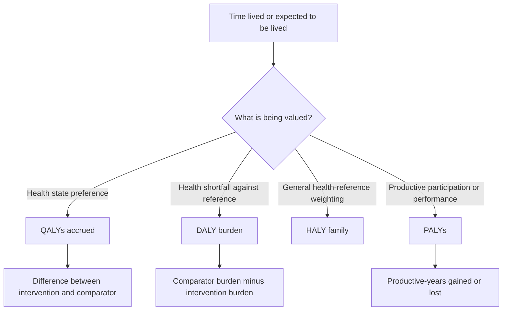
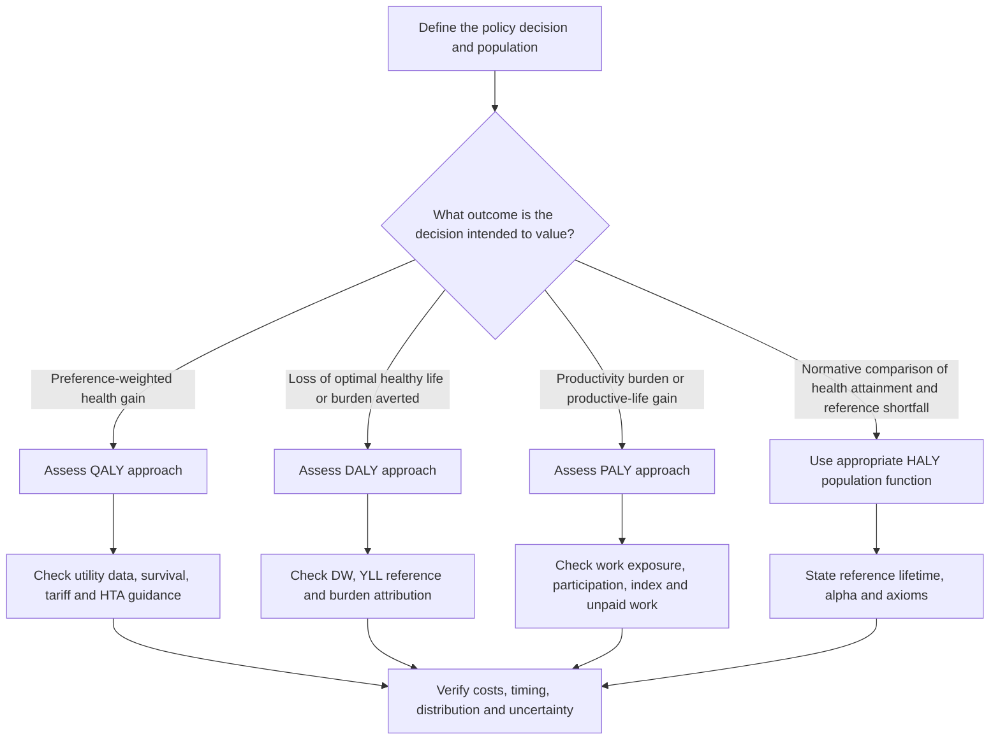

# QALYs, DALYs, HALYs and PALYs

## A comprehensive tutorial on health, disability, life expectancy and productivity outcomes

**Audience:** Health economists, HTA analysts, epidemiologists, outcomes researchers and advanced learners.  
**Format:** Standalone Markdown, including GitHub-compatible LaTeX/MathJax, Mermaid diagrams, original worked examples and calculation tables.  
**Version:** 1.0, 9 November 2026.  
**Scope:** QALY and DALY calculation, the formal HALY family, PALY measurement, integrated evaluation and critical appraisal.

> **How to read this tutorial.** Start with Part I if you want the intuition. Parts II to V explain each measure separately. Part VI compares their mathematical and normative assumptions. Part VII applies all four to one **internally consistent hypothetical cohort**. The appendices provide reproducible arithmetic and audit checklists. **All unsourced parameter values in examples are invented for teaching, not published clinical estimates.** Published quantitative examples are explicitly marked and cited to the supplied papers.

> **Important methodological distinction.** *HALY* is often an umbrella label for health-adjusted life years, not a single routinely applied outcome with one universal algorithm. Moreno-Ternero, Platz and Østerdal [R2] characterise a **specific one-parameter family of population-health evaluation functions**, in which a QALY-based function and a sign-reversed DALY-loss function are limiting cases. We will use their exact mathematical convention in the HALY section. A *PALY* instead captures productive life-years and is not simply a member of that health-only family.

## Contents

- [Part I. Foundations](#part-i-foundations)
  - [1. Why adjusted life-years?](#1-why-adjusted-life-years)
  - [2. One mathematical idea behind many outcomes](#2-one-mathematical-idea-behind-many-outcomes)
- [Part II. QALYs](#part-ii-quality-adjusted-life-years-qalys)
  - [3. Demystifying QALYs](#3-demystifying-qalys)
  - [4. Where utility weights come from](#4-where-utility-weights-come-from)
  - [5. Calculating QALYs](#5-calculating-qalys)
  - [6. QALYs in health economic models](#6-qalys-in-health-economic-models)
- [Part III. DALYs](#part-iii-disability-adjusted-life-years-dalys)
  - [7. Demystifying DALYs](#7-demystifying-dalys)
  - [8. Years of life lost](#8-years-of-life-lost-yll)
  - [9. Years lived with disability](#9-years-lived-with-disability-yld)
  - [10. Total DALYs and DALYs averted](#10-total-dalys-and-dalys-averted)
  - [11. DALYs in policy and evaluation](#11-dalys-in-policy-and-evaluation)
- [Part IV. HALYs](#part-iv-health-adjusted-life-years-halys)
  - [12. What the HALY family means](#12-what-the-haly-family-means)
  - [13. The unified mathematics](#13-the-unified-mathematics)
  - [14. The ethical axioms behind the functions](#14-the-ethical-axioms-behind-the-functions)
- [Part V. PALYs](#part-v-productivity-adjusted-life-years-palys)
  - [15. Demystifying PALYs](#15-demystifying-palys)
  - [16. Building a productivity index](#16-building-a-productivity-index)
  - [17. Calculating PALYs](#17-calculating-palys)
  - [18. Monetary valuation of PALYs](#18-monetary-valuation-of-palys)
  - [19. What published PALY studies show](#19-what-published-paly-studies-show)
- [Part VI. Comparisons](#part-vi-comparison-and-method-selection)
  - [20. Side-by-side comparison](#20-side-by-side-comparison)
  - [21. When QALYs and DALYs agree or disagree](#21-when-qalys-and-dalys-agree-or-disagree)
  - [22. Choosing a measure](#22-choosing-a-measure)
- [Part VII. Worked applications](#part-vii-integrated-worked-applications)
  - [23. One intervention, four perspectives](#23-one-intervention-four-perspectives)
  - [24. Additional scenarios that reveal the differences](#24-additional-scenarios-that-reveal-the-differences)
- [Part VIII. Implementation and appraisal](#part-viii-implementation-and-appraisal)
  - [25. Calculation templates and numerical quality assurance](#25-calculation-templates-and-numerical-quality-assurance)
  - [26. Reporting and critically appraising studies](#26-reporting-and-critically-appraising-studies)
- [Appendix A. Equation reference](#appendix-a-equation-reference)
- [Appendix B. Answered exercises](#appendix-b-answered-exercises)
- [Appendix C. Source-specific published examples](#appendix-c-source-specific-published-examples)
- [Appendix D. Glossary](#appendix-d-glossary)
- [Appendix E. References and provenance](#appendix-e-references-and-provenance)

---

# Part I. Foundations

## 1. Why adjusted life-years?

**Learning message:** Survival, health and productivity describe different consequences of illness. A single unadjusted life-year cannot express all three.

### 1.1 Begin with two patients

Imagine two people observed for four years:

| Feature | Person A | Person B |
|---|---:|---:|
| Years alive | 4 | 4 |
| Average health utility | 0.90 | 0.50 |
| Average productivity index | 0.80 | 0.30 |
| Unadjusted life-years | 4 | 4 |
| QALYs | $4\times0.90=3.60$ | $4\times0.50=2.00$ |
| PALYs | $4\times0.80=3.20$ | $4\times0.30=1.20$ |

Both have four life-years. Yet they do not have the same health experience or productive participation. A QALY gives more weight to years lived in preferred health states; a PALY gives more weight to years with greater productive capacity or activity. Neither weight is a probability of remaining alive.

A disability-adjusted life-year (DALY) takes the opposite starting point: **How much healthy life was lost relative to a defined reference?** If we assume, purely for this example, that disability weight equals $1-u$ and no life-years were lost against a four-year reference, Person A loses $4(1-0.90)=0.40$ healthy years and Person B loses $4(1-0.50)=2.00$. These are *constructed* disability weights, not actual GBD valuations.

### 1.2 Four questions, four lenses

| Question | Primary outcome concept | Orientation |
|---|---|---|
| How much preference-weighted health was lived or gained? | QALY | Health attainment/gain |
| How many healthy years were lost to illness and early death? | DALY | Health burden/loss |
| How should a population-health function balance realised health against a reference lifetime? | HALY family in [R2] | Generalised attainment/shortfall |
| How much productive time was lived or lost? | PALY | Productivity attainment/loss |

**Do not confuse the outcome with the objective of the analysis.** QALYs can be used to calculate *QALYs lost* from disease. DALYs can be used to calculate *DALYs averted* by intervention. PALYs can be reported as achieved productive years or lost productive years. The labels are conventional starting points, not exclusive use cases. [R1–R4]

### 1.3 Burden, benefit, and the counterfactual

A **counterfactual** is the outcome that would have occurred under a different, specified condition, such as no disease or no intervention. Every incremental health measure requires one.

- **Absolute QALYs:** QALYs accrued under a specified strategy.
- **QALYs gained:** QALYs under intervention minus QALYs under comparator.
- **DALY burden:** Healthy years lost in a population against a stated normative life and health reference.
- **DALYs averted:** DALY burden under comparator minus DALY burden under intervention.
- **PALYs lost:** Productive years under a reference, often a cohort without the condition, minus those with the condition.

A common error is to report total DALYs projected after intervention as if they were *DALYs averted*. Those are not the same calculation. [R1, Box 1]

### 1.4 A visual map



**Interpretation:** The *same clinical cohort* can be evaluated through different outcome lenses. The results answer different questions, so their numerical magnitudes need not agree.

## 2. One mathematical idea behind many outcomes

**Learning message:** Most adjusted life-year calculations are a weighted sum of time, but the meaning and source of the weight determine the meaning of the answer.

### 2.1 Start with time

With $T$ years lived, unadjusted life-years are simply

$$LY=T.$$

If a constant weight $w$ applies throughout those years, then

$$A=T\times w.$$

If $w$ changes between intervals $j=1,\ldots,J$:

$$A=\sum_{j=1}^{J}\Delta t_j w_j.$$

Here, $\Delta t_j$ is the length of interval $j$ in years. The symbol $A$ is deliberately generic: it becomes QALYs only when $w$ is the appropriate preference-based health utility; it becomes PALYs when $w$ is the appropriately constructed productivity index.

### 2.2 A curve tells the same story

For continuous time $t$, let $w(t)$ be a changing weight:

$$A(0,T)=\int_0^T w(t)\,dt.$$

The integral is simply the **area under the weight-versus-time curve**. You can understand it without calculus: divide the timeline into short pieces, calculate `duration × weight` for each piece, and add the pieces. Narrower pieces give a closer approximation when the weight changes continuously.

### 2.3 Survival must be included

If an individual may die before $T$, a year of utility only accrues if they are alive. Let $S(t)$ be the probability of surviving beyond $t$ and $u(t)$ be average utility *conditional on being alive*. Then, under a consistent survivor utility definition,

$$E[QALY(0,T)]=\int_0^T S(t)u(t)\,dt.$$

Likewise, if $p(t)$ is a productivity index conditional on being alive and eligible for the productive activity being modelled,

$$E[PALY(0,T)]=\int_0^T S(t)p(t)\,dt.$$

The function $S(t)$ already accounts for mortality. **Do not also apply a mortality reduction factor inside the productivity index without a clear, non-overlapping rationale.** The 2025 PALY review documents variation in treatment of mortality and discusses this issue. [R3]

### 2.4 A small manual integration example

Assume an individual has three years with utilities 0.90, 0.70 and 0.50, and survives all three years:

$$Q=1(0.90)+1(0.70)+1(0.50)=2.10\;QALYs.$$

If a different treatment gives 0.90, 0.80 and 0.70:

$$Q'=0.90+0.80+0.70=2.40,\qquad \Delta Q=2.40-2.10=0.30.$$

Notice the distinction between **0.30 QALYs** and **0.30 life-years**: here the difference is wholly due to health-state values, not survival.

### 2.5 Aggregation: individual to population

If each of $N$ people has $Q_i$ QALYs,

$$Q_{population}=\sum_{i=1}^{N}Q_i.$$

Under conventional unweighted aggregation, one additional QALY has the same numerical weight regardless of recipient. This is an accounting choice and a normative assumption; it is not proof that distributional fairness has been addressed. [R1, §2.1 and §2.5; R2, §§2–3]

### 2.6 Discounting and timing

**Discounting** expresses future outcomes in present-value terms, applying lower present weights to outcomes occurring later. For annual outcomes $A_j$ at the midpoint of year $j$ and an annual outcome discount rate $r$,

$$A_{discounted}=\sum_{j=1}^{J}\frac{A_j}{(1+r)^{j-0.5}}.$$

The midpoint convention reflects a specific timing assumption, not a universal rule. For end-of-year outcomes the exponent is $j$; for outcomes with known event times use those times. Continuous discounting uses $e^{-rt}$ instead of $(1+r)^{-t}$, and these are not numerically identical unless rates are translated appropriately.

**Illustration:** 0.80 QALYs accrued during year 1 are worth $0.80/(1.03)^{0.5}\approx0.7883$ discounted QALYs with midpoint timing, versus $0.80/1.03\approx0.7767$ with end-year timing.

> **Source boundary:** [R1] explains that modern GBD *burden estimates* do not discount DALYs, whereas economic evaluations of DALYs averted frequently discount health effects in accordance with their decision context. The fact that one analysis discounts and another does not is not necessarily a calculation error.

---

# Part II. Quality-Adjusted Life Years (QALYs)

## 3. Demystifying QALYs

**Learning message:** A QALY is a year of life weighted by a preference-based valuation of the health experienced during that year. Utility is not disease severity, survival probability, or the percentage of a person who is healthy.

### 3.1 The basic equation

For constant utility $u$ over $T$ years,

$$QALY=T\times u.$$

Conventional anchors are **1 = full health** and **0 = dead**. Some valuation systems assign values below 0 to states considered worse than dead. Consequently, the statement that utilities always range from zero to one is not universally correct. [R1, §2]

A patient who lives two years at utility 0.60 gains $2\times0.60=1.20$ QALYs. This does *not* mean the patient has a 60% probability of living for two years. Survival is modelled separately.

### 3.2 Decomposing an incremental gain

For two strategies with constant survival times $T_0,T_1$ and utilities $u_0,u_1$:

$$\Delta Q=T_1u_1-T_0u_0.$$

Algebraically,

$$\Delta Q=\underbrace{(T_1-T_0)u_0}_{\text{more time at old utility}}+\underbrace{T_1(u_1-u_0)}_{\text{utility improvement over intervention time}}.$$

This decomposition is exact for the stated constant-weight scenario. It is descriptive, not a causal mediation decomposition; assigning gains to survival versus utility depends on the ordering used.

**Example:** Standard care gives three years at utility 0.60 ($1.80$ QALYs). Treatment gives four years at utility 0.70 ($2.80$ QALYs). The gain is $1.00$ QALY:

- Additional duration valued at old utility: $(4-3)\times0.60=0.60$.
- Utility improvement over four treated years: $4(0.70-0.60)=0.40$.
- Total: $0.60+0.40=1.00$ QALY.

### 3.3 Negative utilities

Suppose a transient health state has utility $-0.20$ and lasts six months. Its accrued QALY contribution is

$$0.5(-0.20)=-0.10.$$

This is a mathematically valid contribution under a value set that permits negative utilities. It is *not* a negative amount of survival. Whether and how to apply such values must follow the valuation system and decision framework. [R1]

### 3.4 Why a QALY is not a direct patient-reported outcome

An EQ-5D descriptive profile or a symptom score describes health. To become a QALY weight, it must be mapped to a **preference-based value set** anchored at death and full health. Multiplying a raw 0–100 symptom scale by survival years would not automatically produce QALYs. [R1, §2.2 and Box 1]

## 4. Where utility weights come from

**Learning message:** The instrument, respondents and valuation method matter as much as the final utility value, especially when extrapolating across countries or populations.

### 4.1 Direct methods

**Time trade-off (TTO):** A respondent considers the trade-off between a longer duration in an impaired state and a shorter duration in full health.

*Simple teaching example:* A respondent is indifferent between 10 years in health state H and 8 years in full health. Under the conventional linear-time TTO representation,

$$u(H)=\frac{8}{10}=0.80.$$

This assumes that the respondent's trade-off can be represented by a constant proportional utility weight and the protocol's other assumptions hold. This is an illustration, not a generic result for every TTO variant, particularly states worse than dead.

**Standard gamble (SG):** Respondents compare a certain impaired health state with a gamble between full health and death. In a simplified expected-utility representation, indifference to an 80% chance of full health and 20% chance of death implies $u(H)=0.80$. Risk attitudes and framing can affect empirical responses.

**Visual analogue scale (VAS):** People place states on an intuitive rating scale. It is useful descriptively, but a VAS score is not automatically a choice-based utility anchored in the same way as TTO or SG. [R1, §2.2]

### 4.2 Indirect methods

Preference-based instruments describe a person's health through domains, then apply a valuation algorithm or **tariff** (a value set translating health profiles into utilities). Examples described in [R1] include EQ-5D, SF-6D, the Health Utilities Index and AP-7D.

For the same health profile, two national tariffs may produce different utilities. Therefore, never combine estimates from different tariffs or questionnaires silently. Record the instrument, version, value-set country, respondent source, collection time and any mapping model.

### 4.3 Whose preferences?

There are two separate steps:

1. **Describing the health state:** Often the patient or a proxy completes the questionnaire.
2. **Valuing that profile:** Often a general-population sample supplies the tariff.

Patient experiences and general-population hypothetical valuations can differ. Neither value is a simple, context-free biological characteristic. [R1, §§2.2–2.5]

### 4.4 Population norms and age

Utility in people without a target disease often falls below 1 because of other conditions and ageing. Suppose the expected five-year utility without the disease is 0.90, not 1.00. Over five years the reference contains $4.50$, not $5.00$, QALYs. A disease trajectory yielding 3.50 QALYs therefore causes $4.50-3.50=1.00$ QALY lost against a realistic norm, rather than $1.50$ against ideal perfect health. [R1, §2.3–2.4]

For incremental comparisons, the same external reference often cancels algebraically, **but only if it is applied consistently**. If population norms also change the projected survivor utilities in the model, they can change the underlying QALY totals, particularly when treatments extend survival to older ages. This distinction is explained in [R1].

### 4.5 Risk and preferences

Classical QALY representations commonly rely on restrictions including separability of health and duration, constant proportional trade-offs and risk neutrality over life-years. These are substantive empirical and normative assumptions, not mathematical necessities. Turner et al. [R1, §2.1] discuss departures from them and extensions such as risk-adjusted evaluations and distributional cost-effectiveness analysis (DCEA), which examines who receives benefits and who bears opportunity costs.

## 5. Calculating QALYs

**Learning message:** Assign the correct utility to the correct time, account for survival once, and preserve the comparator definition.

### 5.1 Piecewise constant utilities

| Year | Duration (years) | Utility | QALY contribution |
|---|---:|---:|---:|
| 1 | 1 | 0.90 | $1(0.90)=0.90$ |
| 2 | 1 | 0.70 | $1(0.70)=0.70$ |
| 3 | 1 | 0.50 | $1(0.50)=0.50$ |
| **Total** | **3** | | **2.10** |

The whole arithmetic is $0.90+0.70+0.50=2.10$.

### 5.2 Intermittently observed utility: trapezoidal rule

**Trapezoidal rule** means assuming a straight-line change between consecutive observations and calculating the area beneath it.

Suppose utility is measured at months 0, 12 and 24: $u_0=0.50$, $u_1=0.70$, $u_2=0.80$.

$$Q_{0\to1}=\frac{0.50+0.70}{2}(1)=0.60,$$
$$Q_{1\to2}=\frac{0.70+0.80}{2}(1)=0.75,$$
$$Q_{0\to2}=0.60+0.75=1.35.$$

**Why not $0.50+0.70+0.80=2.00$?** Those are three observations, not three full-year exposures. A measurement has no intrinsic duration. The interval lengths provide the durations.

If someone dies between visits, never extend their observed utility beyond death. Missing data and informative dropout require a prespecified estimation strategy rather than automatic last-observation carry-forward.

### 5.3 Survival-weighted QALYs

Suppose we model three one-year cycles and use the **midcycle average proportion alive**:

| Year | Proportion alive during year | Utility among alive | Cohort QALY per initial patient |
|---|---:|---:|---:|
| 1 | 0.90 | 0.80 | $0.90(0.80)=0.720$ |
| 2 | 0.80 | 0.75 | $0.80(0.75)=0.600$ |
| 3 | 0.70 | 0.70 | $0.70(0.70)=0.490$ |
| **Total** | | | **1.810** |

The survival proportions represent the expected fraction of initial cohort time lived. They are **not** probabilities of being in a specific nonfatal health state unless the model defines them that way.

### 5.4 Multiple health states

Suppose an oncology cohort in one year has average proportions 0.80 progression-free, 0.15 progressed and 0.05 dead. With utilities $u_{PF}=0.80$, $u_{PD}=0.50$, $u_D=0$:

$$Q_{year}=1[0.80(0.80)+0.15(0.50)+0.05(0)]=0.715.$$

Notice that $0.80+0.15+0.05=1$. If a model reports the proportions *at only the start or end of a year*, additional assumptions are needed to estimate **time spent** in each state. Multiplying end-of-cycle states by one full year is not exact.

### 5.5 Adverse events

Assume an adverse event reduces utility by 0.20 for 14 days. Its disutility is

$$d=0.20\times\frac{14}{365}=0.007671\;QALYs.$$

If the event occurs with probability 0.30, the expected decrement per treated patient is

$$E[d]=0.30(0.007671)=0.002301.$$

**Avoid double counting:** If the health-state utility was collected during the event and already captures it, a second adverse-event disutility may be inappropriate.

### 5.6 QALYs lost and gained

Let $Q_D$ denote QALYs with disease, $Q_R$ QALYs in the reference without that disease, $Q_T$ treated QALYs and $Q_C$ comparator QALYs:

$$QALYs\ lost=Q_R-Q_D,$$
$$QALYs\ gained=Q_T-Q_C.$$

These formulas address different counterfactuals. An intervention's effect need not equal the total disease burden it could theoretically prevent. [R1, §2.4]

### 5.7 Discounting by cycle

With $r=3\%$, annual outcomes 0.90, 0.70 and 0.50, and midpoint timing:

$$Q^{disc}=\frac{0.90}{1.03^{0.5}}+\frac{0.70}{1.03^{1.5}}+\frac{0.50}{1.03^{2.5}}.$$

A table should be kept in the model with raw QALY, event time, discount factor and discounted QALY. Do not discount a previously discounted output again.

### 5.8 Unit checks

- Utility is dimensionless; duration is in **years**; therefore their product is QALYs.
- If duration is in **months**, divide by 12.
- If a decrement is applied for **days**, divide by the relevant annual-day convention (usually 365 in teaching examples; be explicit in applications).
- Per-cycle and annual utilities are not separate units: it is the time exposure that determines the calculation.

## 6. QALYs in health economic models

**Learning message:** Models differ in how they estimate time spent in health states, not in the fundamental definition of a QALY.

### 6.1 Decision tree

For terminal branches $b$ with probability $\pi_b$ and branch-specific QALYs $Q_b$:

$$E[Q]=\sum_b\pi_bQ_b.$$

Example: success probability 0.70 leads to 2.0 QALYs; failure 0.30 leads to 0.8 QALYs:

$$E[Q]=0.70(2.0)+0.30(0.8)=1.64.$$

### 6.2 State-transition cohort model

Let $x_{j,s}$ be the proportion in state $s$ during cycle $j$, $u_s$ its utility and $\Delta t$ cycle length:

$$Q=\sum_j\sum_s x_{j,s}u_s\Delta t.$$

Apply appropriate within-cycle occupancy estimates or a consistent half-cycle correction; do not assume start-of-cycle occupancy is necessarily the annual average.

### 6.3 Partitioned survival model

With progression-free survival $PFS(t)$ and overall survival $OS(t)$, assuming nested states:

$$P(PF,t)=PFS(t),$$
$$P(PD,t)=OS(t)-PFS(t),$$
$$P(Dead,t)=1-OS(t).$$

Therefore,

$$Q=\int_0^T\left[PFS(t)u_{PF}(t)+\{OS(t)-PFS(t)\}u_{PD}(t)\right]dt.$$

The formula requires coherent $0\le PFS(t)\le OS(t)\le1$. If independently fitted survival curves cross, model output can give negative progressed-state occupancy, which is a **structural inconsistency** to resolve, not a negative health state. Treatment-on and treatment-off utility differences need additional explicit occupancy or duration-of-treatment assumptions.

### 6.4 Costs and incremental outcomes

Given costs $C_T,C_C$ and QALYs $Q_T,Q_C$:

$$\Delta C=C_T-C_C,\quad\Delta Q=Q_T-Q_C,\quad ICER=\frac{\Delta C}{\Delta Q}.$$

Suppose $\Delta C=\$3{,}000$ and $\Delta Q=0.15$ QALYs per patient:

$$ICER=3000/0.15=\$20{,}000\text{ per QALY gained}.$$

The ICER is hard to interpret when $\Delta Q=0$ and must be interpreted with the **cost-effectiveness plane** when one option dominates the other or results fall in different quadrants. At a willingness-to-pay or opportunity-cost threshold $\lambda$, incremental net monetary benefit is

$$INMB=\lambda\Delta Q-\Delta C.$$

At $\lambda=\$30{,}000$/QALY, the example gives $30{,}000(0.15)-3{,}000=\$1{,}500$ per patient. A positive INMB indicates cost-effectiveness *under that specified threshold*, not universal affordability.

### 6.5 Uncertainty and reporting

Model survival parameters, utilities and event durations jointly when correlated; use plausible probability distributions and preserve constraints. Report undiscounted and discounted results, data sources, treatment effects, model horizon, extrapolation and whether patient-reported utilities include adverse events. [R1]

### 6.6 QALY limitations to remember

A conventional QALY aggregates health quantity and a preference valuation; it does not automatically measure caregiver welfare, employment effects, equity or the full social value of an intervention. Generic questionnaires may miss condition-specific effects. Age and disability concerns arise partly because attainable survival gains and baseline utilities differ between groups. These issues cannot be corrected merely by changing a utility parameter without a defensible framework. [R1, §2.5]

---
# Part III. Disability-Adjusted Life Years (DALYs)

## 7. Demystifying DALYs

**Learning message:** DALYs account for healthy life that is *missing*, either because someone dies earlier than a reference lifespan or because time alive is spent in nonoptimal health.

### 7.1 The central equation

$$DALY=YLL+YLD,$$

where **YLL** is *years of life lost because of premature mortality* and **YLD** is *years lived with disability*, meaning healthy-year equivalents lost during time alive. Higher DALYs indicate a greater measured burden. If an intervention reduces burden, the outcome is **DALYs averted**. [R1, §3]

Think of two distinct losses:

1. A disease causes someone to die earlier than a specified reference. This produces **YLL**.
2. Before death, or among survivors, illness reduces health relative to an optimal-health reference. This produces **YLD**.

These components are added because they describe **different parts of a health trajectory**. Illness that lasts until death may contribute YLD before death; the missing time after death contributes YLL. No YLD accumulates *after* death.

### 7.2 Disability weights are not utility decrements by definition

DALYs use **disability weights** $d$ between 0 and 1, where $d=0$ denotes no health loss and $d=1$ denotes a health loss equivalent to death under the valuation convention. QALY utility $u=1$ denotes full health and $u=0$ death, with some utilities negative. The **numerical identity** $d=1-u$ is an optional simplifying assumption in an invented example, **not an empirical identity between QALY and GBD data**. The weights often come from different elicitation exercises and reflect different evaluative concepts. [R1, Tables 1–2]

### 7.3 Three interpretations to keep separate

- **DALY burden:** Total loss relative to a specified health and mortality standard.
- **DALYs averted:** Reduction in burden caused by an intervention, relative to a comparator.
- **DALY rate:** DALYs per specified population denominator (often per 100,000 people) during a stated period; standardisation for age is a separate procedure.

A DALY count is not itself a rate and is not automatically comparable between populations of very different sizes or age distributions.

## 8. Years of life lost (YLL)

**Learning message:** The correct remaining-life comparator is conditional on the age at death. You must state whether a standard reference or a local life table is used.

### 8.1 The equation

For $D_a$ deaths at age $a$ and $e^*(a)$ *reference remaining life expectancy at that age*:

$$YLL=\sum_a D_a\,e^*(a).$$

Here the asterisk indicates the selected **reference**, not the observed survival under the intervention. Global burden studies usually use standardised reference life tables; some economic evaluations use local conditional life expectancy. These choices change the estimated magnitude. [R1, §§3.3.2–3.3.3]

### 8.2 One death, shown fully

A person dies at age 50. Suppose a **hypothetical reference table** gives $e^*(50)=32.4$ remaining years.

$$YLL=1\times32.4=32.4\text{ years}.$$

This does **not** mean the person was biologically certain to live another 32.4 years. It is the *expected* number of reference years not lived, as defined by the chosen life table.

**Wrong shortcut:** If life expectancy at *birth* is 78 years, $78-50=28$ is not generally the remaining life expectancy of someone who has already survived to age 50. It ignores conditional survival. [R1, Box 1]

### 8.3 An age-stratified example

| Age at death | Number of deaths | Hypothetical reference years remaining | Calculation | YLL |
|---|---:|---:|---|---:|
| 40 | 2 | 40 | $2(40)$ | 80 |
| 50 | 3 | 32 | $3(32)$ | 96 |
| 65 | 1 | 19 | $1(19)$ | 19 |
| **Total** | **6** | | $80+96+19$ | **195** |

The numbers in the life-table column are invented. Applied studies must replace them with the reference source appropriate to their purpose.

### 8.4 Where does the time get attributed?

In common GBD accounting, if someone dies in year 2026 with 30 reference years remaining, **all 30 YLL are attributed to the year of death**. They do not appear as one YLL in each future calendar year in the reported annual incident YLL figure. This is different from a model that reports health actually experienced in each later year. The distinction is essential when comparing GBD DALY counts with a finite-horizon QALY model. [R1, §3.3.2]

### 8.5 Standard versus local tables

A standard mortality reference supports comparison across settings without deeming a death less burdensome simply because observed local life expectancy is shorter. A local life table may answer a decision maker's question about projected outcomes for a particular population more directly. **Neither reference choice is neutral**: explain its role in the decision question and avoid changing it between comparator and treatment without substantive justification. [R1]

## 9. Years lived with disability (YLD)

**Learning message:** YLD counts the time lived in a health-loss state, multiplied by the disability weight. Incidence-based and prevalence-based YLDs allocate time differently.

### 9.1 Episode-based calculation

For one episode of duration $L$ years and disability weight $d$:

$$YLD=Ld.$$

For $N$ identical episodes:

$$YLD=N\,L\,d.$$

**Example: acute disease.** One hundred patients each have a 14-day episode, with an *illustrative* $d=0.20$:

$$L=14/365=0.038356\text{ years},$$
$$YLD=100(14/365)(0.20)=0.767123.$$

Do not multiply by a full year merely because the illness occurred during that year. Duration is part of the measurement. [R1, §3.3.1]

### 9.2 A chronic illness

One patient experiences a disability weight 0.40 for four consecutive years:

$$YLD=4(0.40)=1.60.$$

If 50 patients each experience the same four-year history, the **total four-year burden** is $50(1.60)=80$ YLDs, not 20 YLDs. Conversely, if the question asks about **one calendar year's prevalent burden** and 50 individuals experience that state throughout that year, the answer is $50(0.40)=20$ YLDs for *that year*. Reporting period is decisive.

### 9.3 Incidence-based and prevalence-based counting

**Incidence** is new cases arising during a period; **prevalence** is existing cases in a population at a specified time or averaged during a period.

| Method | What is counted? | Simplified equation | Interpretation |
|---|---|---|---|
| Incidence-based YLD | Future disability attributable to cases beginning in index year | $\sum_{cases}d\times duration$ | Lifetime or episode burden allocated to **onset year** |
| Prevalence-based YLD | Disability experienced among prevalent cases within reporting year | $\sum_{states}person\text{-}years_{state}\times d_{state}$ | Disability occurring **during the year** |

The modern GBD framework uses prevalence-based YLDs. Historical studies may use incidence-based methods; their reported annual patterns are not automatically comparable. [R1, §3.3.1]

**Worked distinction:** Ten new patients develop a disease in 2026 that lasts three years at disability weight 0.20, with no deaths or recovery within that period.

- **Incidence-based allocation to 2026:** $10\times3\times0.20=6.0$ YLDs attributed to 2026.
- **Prevalence-based 2026:** $10\times1\times0.20=2.0$ YLDs experienced in 2026, assuming all are present for a full year.
- **Prevalence-based 2027 and 2028:** 2.0 each year, for total 6.0 over the three-year episode.

The **total undiscounted disability burden** agrees in this artificially simple, closed cohort. The **calendar-year accounting** differs. Incidence and prevalence will also differ in real data because onset timing, recovery, mortality and population turnover vary.

### 9.4 Changing severity

A patient experiences severe disease ($d=0.60$) for 30 days, followed by mild disease ($d=0.10$) for 335 days:

$$YLD=\frac{30}{365}(0.60)+\frac{335}{365}(0.10)$$
$$=0.049315+0.091781=0.141096.$$

Applying one disability weight to the whole year would misrepresent the disease trajectory unless that weight were a defensible time-weighted average.

### 9.5 Comorbidity

Suppose two conditions independently produce illustrative disability weights $d_1=0.20$, $d_2=0.30$. Simply adding gives $0.50$ but can be problematic, especially as totals may exceed 1. A commonly used *multiplicative-combination illustration* is

$$d_{combined}=1-(1-d_1)(1-d_2),$$
$$d_{combined}=1-(0.80)(0.70)=0.44.$$

For a full year this gives 0.44 YLD, not 0.50. **This formula assumes a particular combination rule** and is not a substitute for documented GBD comorbidity adjustment or condition-specific joint-state estimates. Do not apply it automatically when the selected weights already describe combined states.

### 9.6 Sources and interpretation of disability weights

In contemporary GBD work, disability weights derive from population judgments about the healthfulness of described sequelae. [R1] documents a shift from older expert-assigned disability classes and person-trade-off approaches to paired-comparison and population-survey methods since GBD 2010. The modern concept is deliberately narrower than overall well-being, social stigma or economic disadvantage. A condition's employment impact therefore does not directly determine its GBD weight.

**Data audit:** Record the exact GBD iteration, sequela definition, disability weight, episode duration and whether any severity split or comorbidity correction has been used. Mixing historical and contemporary weights is not a harmless simplification. [R1, §3.2]

## 10. Total DALYs and DALYs averted

**Learning message:** The outcome called *DALYs averted* is a difference between **two coherent burden estimates**, with the same standard, attribution conventions and relevant time basis.

### 10.1 Simple complete example

Suppose standard care is associated with 10 deaths at an illustrative remaining-reference expectancy of 30 years and 100 patient-years with disability weight 0.25:

$$YLL_C=10(30)=300,$$
$$YLD_C=100(0.25)=25,$$
$$DALY_C=300+25=325.$$

Suppose an intervention produces 6 deaths with the same reference years remaining and 80 patient-years at disability weight 0.20:

$$YLL_T=6(30)=180,$$
$$YLD_T=80(0.20)=16,$$
$$DALY_T=180+16=196.$$

Therefore:

$$DALYs\ averted=325-196=129.$$

**Why the result is not simply 4 deaths × 30:** Mortality contributes $(10-6)30=120$ YLL averted, while morbidity contributes $25-16=9$ YLD averted; $120+9=129$.

**Assumptions:** These are two hypothetical scenarios with comparable populations, a consistent reference and intentionally simplified episode exposures. A full disease model must ensure that the disability person-years are coherent with deaths, especially when survival is improved. Any additional time alive may create *additional* YLD if the person survives with some illness; one cannot arbitrarily reduce both components.

### 10.2 DALYs averted in a cost-effectiveness analysis

If the incremental intervention cost is $\$258{,}000$, then

$$\frac{\Delta C}{DALYs\ averted}=\frac{258{,}000}{129}=\$2{,}000\text{ per DALY averted}.$$

Interpret this against an appropriately derived opportunity-cost threshold or policy objective. Avoid treating a country's GDP per capita as an automatically valid threshold without justification.

### 10.3 Two legitimate conventions, different purposes

| Choice | Modern GBD burden estimation | Economic evaluation using DALYs averted |
|---|---|---|
| Mortality reference | Standardised life table | Often GBD reference or justified local conditional life expectancy |
| YLD | Primarily prevalence-based | Align with modelled intervention and reporting period |
| Age weighting | Not used since GBD 2010 | Usually not used |
| Discount health outcomes | Not applied in current GBD burden estimates | May apply, depending on economic evaluation guidance |
| Primary output | DALYs lost | DALYs averted and cost per DALY averted |

Source: [R1, Tables 1–2 and §§3–4]. For economic evaluation, time-discounting requires clarity about how **future healthy life lost due to death** is valued, not just a discount factor slapped onto a reported GBD total.

### 10.4 Why the time horizon matters

Suppose a five-year trial prevents death in its third year. A QALY analysis limited to five years captures only the health gained through year 5. A standard YLL calculation at death may attribute many *remaining reference years* to that death. Both estimates can be internally valid but cover different horizons. Comparing them numerically as though they measure identical future periods is misleading. This issue is central to our integrated example in Chapter 23.

### 10.5 Frequent DALY calculation failures

1. Applying the disability weight for 365 days when a disease lasted 14 days.
2. Using a life expectancy at birth minus age at death for YLL.
3. Failing to say whether YLD is incidence- or prevalence-based.
4. Calling total post-treatment burden “DALYs averted.”
5. Combining disability weights from incompatible vintages.
6. Applying historical age weighting or burden discounting while claiming to follow current GBD conventions.
7. Mixing local and global reference lifetimes without declaring the reason.
8. Failing to distinguish sequelae from diagnoses and to handle comorbidity coherently.

These problems follow the warnings and methodological developments discussed in [R1].

## 11. DALYs in policy and evaluation

**Learning message:** DALYs are particularly useful for describing *population health loss* across causes, settings and time, but comparing their totals requires consistent definitions and standards.

### 11.1 Burden of disease versus cost-effectiveness

A high burden of disease indicates a potentially important health problem. It does **not**, on its own, prove that an available intervention is cost-effective, affordable or implementable. Intervention effect size, reach, cost, comparator and feasibility determine preventable burden. For example, a disease may create 100,000 DALYs of annual burden while an available programme averts only 1,000 DALYs.

### 11.2 Published use cases described by [R1]

The Turner et al. paper describes DALYs in GBD, public-health programmes and economic evaluation, including infectious disease interventions. It also notes that QALY-based evaluations have been common in high-income health technology assessment, while DALYs averted have historically been prominent in global health and lower-income settings. This is a broad literature pattern, **not a rule requiring one metric in a specific country**.

### 11.3 Ethical limits

The disability weight intentionally values lost healthfulness, not every impact on employment, relationships or capabilities. The use of standard lifetimes is intended to avoid treating deaths in lower-life-expectancy settings as less important, but the approach remains normative. Conditions that create serious life consequences without large departures from narrow “healthfulness” can be undervalued in the DALY framework. [R1, §3.4]

---

# Part IV. Health-Adjusted Life Years (HALYs)

## 12. What the HALY family means

**Learning message:** The HALY concept unites health *achieved* and health *missing from a reference*. The special model in [R2] shows exactly how QALY and sign-reversed DALY functions are connected.

### 12.1 Do not invent a universal HALY calculator

In public-health literature, *health-adjusted life years* can refer broadly to life-years weighted for health. In [R2], HALYs are a formally characterised **family of population health evaluation functions (PHEFs)**. There is no claim that every HALY study operationally uses the same $\alpha$ model. We will explain the specific family proposed by Moreno-Ternero et al., rather than mislabelling it as a universal fourth metric.

### 12.2 The three ingredients

For individual $i$, [R2] uses a triplet $(a_i,t_i,r_i)$:

- $a_i$: health state (which maps to health value $q(a_i)$).
- $t_i$: actual lifetime or time alive under the specified profile.
- $r_i$: **reference lifetime**, with $r_i\ge t_i$ in their basic formal domain.

The individual may have a single average health state over the chosen time, and the authors discuss how the framework can represent trajectories. The basic time-linear functions assume health values in $[0,1]$; this differs from QALY applications allowing negative health-state utilities. That is a **restriction of the formal theorem's domain**, not evidence that negative health values never occur.

### 12.3 Attainment versus shortfall

A person with reference lifetime 10 years, actual lifetime 8 years and average health value 0.75 has:

$$\text{Health attained}=8(0.75)=6\text{ adjusted years},$$
$$\text{Health shortfall}=10-6=4\text{ adjusted years}.$$

The shortfall can be split arithmetically into:

$$10-8=2\text{ missing life-years},$$
$$8(1-0.75)=2\text{ lost health-equivalent years while alive}.$$

Hence $2+2=4$. This complement identity relies on using the *same* health valuation and reference definition throughout. It does not prove that published GBD DALYs numerically equal QALYs foregone. [R2, §2.1]

## 13. The unified mathematics

**Learning message:** The key additional quantity in the HALY family is a **reference lifetime**. Its influence is controlled by $\alpha$.

### 13.1 Three functions from the original paper

For a population of $N$ individuals, define

$$P^q=\sum_{i=1}^Nq(a_i)t_i,$$

$$P^d=\sum_{i=1}^N\{q(a_i)t_i-r_i\},$$

$$\boxed{P^h_\alpha=\sum_{i=1}^N\{q(a_i)t_i-\alpha r_i\}.}$$

These are the **time-linear QALY, sign-reversed DALY and HALY population evaluation functions** in [R2, equations (1)–(3)]. The superscript $d$ in $P^d$ does *not* mean an ordinary positive DALY burden. The authors use **negative health shortfall** so that a *higher* $P^d$ is preferable.

Set

$$Q=\sum_i q(a_i)t_i,\qquad R=\sum_i r_i.$$

Then

$$P^h_\alpha=Q-\alpha R.$$

When $\alpha=0$: $P^h_0=Q=P^q$.  
When $\alpha=1$: $P^h_1=Q-R=P^d$.  
In the convex subfamily $0\le\alpha\le1$, intermediate $\alpha$ values interpolate between those endpoints. The authors establish additional axiomatic conditions for this restricted subfamily. [R2, §3]

### 13.2 Work the equation by hand

With $q=0.75$, $t=8$ years, $r=10$ years:

| $\alpha$ | Calculation | HALY population-evaluation score |
|---:|---|---:|
| 0 | $8(0.75)-0(10)$ | $6.00$ |
| 0.25 | $6-0.25(10)$ | $3.50$ |
| 0.50 | $6-0.50(10)$ | $1.00$ |
| 0.75 | $6-0.75(10)$ | $-1.50$ |
| 1 | $6-1(10)$ | $-4.00$ |

**Crucial:** A negative score for $\alpha=1$ is not a negative number of DALYs suffered. It is the *negative of the positive shortfall* (four adjusted years lost). The utility of the score is in **comparing profiles under a consistently specified function**.

### 13.3 What happens if the reference does not change?

For treatment and comparator,

$$\Delta P^h_\alpha=(Q_T-Q_C)-\alpha(R_T-R_C).$$

If both strategies apply to the same population with the **same reference lifetime total**, $R_T=R_C$, so

$$\boxed{\Delta P^h_\alpha=\Delta Q\quad\text{for every }\alpha.}$$

This is a central result: under these conditions, changing $\alpha$ changes **absolute levels** but not the **incremental ranking**. In [R2, conclusion], fixed reference lifetimes make the time-linear functions informationally equivalent. If someone claims to obtain a different intervention ranking merely by moving $\alpha$ while keeping every other input and reference fixed, investigate the calculation.

### 13.4 What if reference lifetimes differ?

Suppose we compare **two population health profiles with different reference totals**, not two arbitrary treatments on an otherwise identical population:

| Profile | $Q$ | $R$ | $P^h_0$ | $P^h_{0.5}$ | $P^h_1$ |
|---|---:|---:|---:|---:|---:|
| A | 8.0 | 10 | 8.0 | 3.0 | -2.0 |
| B | 8.4 | 11 | 8.4 | 2.9 | -2.6 |

At $\alpha=0$, B is preferred ($8.4>8.0$). At $\alpha=0.5$, A is preferred ($3.0>2.9$). Why? B attains 0.4 additional adjusted years but has one additional reference year, whose penalty is $\alpha(1)$. The ranking changes when $\alpha>0.4$.

**Interpretation warning:** This is a comparison of distinct *profiles or normative reference configurations*. In a treatment-effect evaluation of the same target population, changing the reference lifespan across arms merely to force a ranking difference is generally unjustified. A different life expectancy *caused by treatment* belongs in actual lifetime $t$, not automatically in the reference $r$.

### 13.5 HALY and a standard GBD DALY are not necessarily identical

The mathematical complement $R-Q$ resembles YLL + YLD **when**:

- The same realised survival period is used.
- The reference lifetime definition is aligned.
- $d=1-q$ holds pointwise for the health valuation.
- Morbidity and mortality attribution cover equivalent horizons.
- Discounting and aggregation conventions agree.

In applied data, QALY tariffs and GBD disability weights typically come from different valuation systems; YLL usually uses an age-specific life table, with future reference years attributed to death year. **Do not interpret equation (2) from [R2] as a license to substitute reported GBD DALY totals for negative QALYs.**

### 13.6 Beyond linear time

[R2, §4] develops more general families involving **healthy years equivalents (HYEs)**. An HYE is a duration in full health regarded as equivalent to the given health trajectory under a specified preference relation. More general functions can be expressed schematically as

$$P=\sum_i g(f(a_i,t_i,r_i),r_i),$$

where $f$ maps to an HYE and $g$ is a transformation meeting the authors' regularity and monotonicity conditions. The simple $q(a)t$ formula is not an assumption-free measure of every kind of lifetime preference. We do not claim the general HYE functions have one routine HTA tariff.

## 14. The ethical axioms behind the functions

**Learning message:** An **axiom** is a rule a social preference ordering is required to obey. Axioms expose what the outcome function considers important, and what it ignores.

### 14.1 The common structural axioms in [R2]

| Axiom | Intuitive meaning | Why it matters |
|---|---|---|
| Anonymity | Exchanging the identities of otherwise-described individuals does not change population evaluation | Excludes identity-based weights |
| Separability | If one subgroup is unchanged, it should not alter the relative evaluation of changes in the other subgroup | Supports additive population comparison |
| Continuity | Small changes in time/reference do not cause arbitrary jumps in ranking | Supports a stable numeric representation |
| Full-health superiority | Replacing a given health state with full health does not worsen evaluation | Recognises full health as best in the specified domain |
| Lifetime monotonicity at full health | More lifetime in full health, holding the reference fixed, is better | Values additional healthy time |
| Positive lifetime desirability | A positive lifetime is not worse than zero lifetime under the model | Excludes worse-than-death health states in this formal domain |
| Social zero | When lifetime is zero, the assigned health-state description does not matter | Avoids value from time never lived |

These are the seven **COMMON** axioms defined in [R2, §2.2]. The source paper also uses **lifetime invariance at common health** and **reference-age invariance at common health** to characterise the time-linear HALY family.

### 14.2 What separates the QALY and DALY endpoints?

- **Reference-lifetime independence at full health:** When someone lives in full health, changing the *reference lifespan* alone does not change the evaluation. This is part of the QALY endpoint characterisation.
- **Gap invariance at full health:** Under full health, the *gap* between actual and reference lifetime drives evaluation. This is part of the sign-reversed DALY endpoint characterisation.

These are distinct normative commitments. Theorems 2 and 3 of [R2] show how each endpoint is characterised when combined with the common axioms and shared additional conditions. You need not learn their proofs to see the implication: **two numerically similar measures may embody different views about whether reference shortfall itself should affect value.**

### 14.3 A critical reading point across the supplied papers

Turner et al. [R1, §2.5] discuss the classical utility-theoretic axiomatic foundation of the QALY and describe a historical contrast with DALYs. Moreno-Ternero et al. [R2] specifically provide **axiomatic characterisations of DALY-type population functions**. These statements describe different theoretical traditions and should not be merged into the broad claim that “DALYs have no formal axiomatic foundation.” For this tutorial, [R2] is the direct source on the population-level axioms.

### 14.4 Does conventional aggregation address equity?

Not by itself. A sum $\sum_i Q_i$ treats equally sized gains as equal contributions regardless of who receives them. It does not automatically prefer gains to people with the greatest lifetime health shortfall, nor does a productivity measure guarantee that people outside paid employment receive equal consideration. [R1] discusses severity modifiers and distributional approaches; [R2] explicitly recognises the distributive limitations of unweighted aggregation; [R3–R4] note concerns around unpaid work and working-age restrictions.

**Exercise:** If $Q_A=10$ and $Q_B=12$ but both have $R=20$, which profile is preferred at $\alpha=0$, $0.5$ and $1$? **Answer:** B at all three values because $P_B-P_A=2$ independent of $\alpha$.

---
# Part V. Productivity-Adjusted Life Years (PALYs)

## 15. Demystifying PALYs

**Learning message:** An illness can substantially change someone's productive contribution even if survival and conventional health utility change only slightly. A PALY quantifies that consequence over time.

### 15.1 From one lost workday to a lost productive year

Consider two employees, each alive and employed for one year. One has no disease-related absence or performance loss; the other misses 24 of 240 scheduled workdays and operates at 80% of normal productivity while present. A PALY framework converts these losses into fractions of one productive year and allows them to be modelled over a working lifetime. This extends familiar absenteeism/presenteeism data from a short questionnaire window into a population outcome measure. [R3–R4]

### 15.2 The PALY identity

With $t$ years alive and a productivity index $p$ between 0 and 1,

$$PALY=t\times p.$$

With time variation:

$$PALYs=\sum_j LY_j\,p_j.$$

$LY_j$ is expected life-years lived during interval $j$; it may already be less than one because of mortality. A year at productivity index 0.70 contributes $0.70$ PALYs, **not** a claim that 70% of a person's worth or well-being has been preserved.

### 15.3 What the index represents

The productivity index may reflect:

- **Absenteeism:** Work time not worked because of illness.
- **Presenteeism:** Reduced productive performance while working.
- **Labour-force participation:** Degree to which people take part in the relevant labour market or productive activities.
- **Premature workforce exit:** Early retirement or permanent departure associated with disease.

The definition is not standardised identically across all published studies. The 2025 scoping review explicitly documents substantial variation in included components. **You must define $p$ operationally before comparing PALYs across studies.** [R3]

### 15.4 PALYs are not simply more QALYs

Suppose an intervention improves mobility enough to let a person return to work, while their EQ-5D-based utility changes from 0.85 to 0.87. The QALY gain over one year is only $0.02$, but the productivity index might increase from 0.30 to 0.80, giving $0.50$ additional PALYs. These represent different evaluative questions, not competing estimates of one underlying effect.

The opposite is possible: palliative care may improve suffering and utility without increasing paid-work output. PALYs are therefore **complementary**, not a replacement for QALYs or DALYs. [R4]

## 16. Building a productivity index

**Learning message:** The arithmetic can be simple, but valid construction of the productivity index requires an explicit denominator and rules for overlap between missed time and reduced performance.

### 16.1 Absenteeism

Let $D$ be expected workdays and $d_{missed}$ disease-related days absent. Define absenteeism as a *proportion*:

$$a=\frac{d_{missed}}{D}.$$

For $D=240$ days and 20 days missed:

$$a=20/240=0.083333=8.333\%.$$

The proportion of scheduled time **worked** is $1-a=0.916667$.

### 16.2 Presenteeism

Let $b$ be the *proportional output loss conditional on being present*. If employees work at 85% of normal performance when present,

$$b=1-0.85=0.15.$$

That is **15% presenteeism-related impairment**, but only in time actually worked. Absenteeism and presenteeism therefore overlap if naively added as if both were measured over the same full-year exposure.

### 16.3 Combining the components without double counting

When definitions are compatible, use:

$$\boxed{p=(1-a)(1-b).}$$

In our example:

$$p=(1-20/240)(1-0.15)$$
$$=(0.916667)(0.85)=0.779167.$$

The employee generates the equivalent of **0.7792 productive years** per nominal full work-year. The 0.2208 reduction incorporates both absence and performance loss.

Compare with naive subtraction:

$$1-a-b=1-0.083333-0.15=0.766667.$$

The difference, $0.0125$, is the portion of impaired performance incorrectly charged to work time already absent. This demonstrates why we need to check questionnaire definitions rather than adding percentages automatically.

### 16.4 Incorporating labour-force participation

If $f$ represents the relevant **fraction of nominal working-life capacity included in productive activity**, one possible composite index is

$$p_{effective}=f(1-a)(1-b).$$

With $f=0.75$:

$$p_{effective}=0.75(0.779167)=0.584375.$$

**Important measurement decision:** Whether to multiply by labour-force participation depends on your base population and the denominator used for the productivity index and the monetary value per PALY. If your index is already relative to workforce-adjusted maximum workdays, or if your population is already restricted to workers, multiplying by $f$ again may double-adjust. [R3–R4]

### 16.5 Relating the source paper's workday convention

Ademi et al. [R4] describe an approach using a country- and age-specific maximum number of workdays based on equivalent full-time participation. Their illustration converts 240 nominal days to 180 expected workdays when equivalent full-time participation is 75%:

$$240(0.75)=180\text{ days}.$$

If that **180-day** denominator has already accounted for participation, do not reflexively multiply an otherwise adjusted productivity ratio by 0.75 again. The arithmetic in section 16.4 illustrates a *different explicit parameterisation*; it is not a command to combine both conventions.

### 16.6 Early workforce exit

Suppose someone would have contributed 0.80 PALYs per year from ages 60 through 64 but retires at 60 because of illness. Five years of lost productive exposure correspond to

$$5\times0.80=4.00\;PALYs\ lost,$$

before mortality and discount adjustments. If some part-time or informal productive activity remains, replace the index of zero with a defensible post-exit value.

### 16.7 Data sources and questionnaire logic

The PALY papers [R3–R4] mention instruments including the **Work Productivity and Activity Impairment (WPAI)** questionnaire and the **iMTA Productivity Cost Questionnaire (iPCQ)**. A practical extraction template should include:

| Field | Example | Why it matters |
|---|---|---|
| Measurement period | Previous 7 days | Short recall may not reflect a whole year |
| Scheduled work hours | 40 hours | Absence denominator |
| Missed hours due to disease | 4 hours | Absenteeism numerator |
| Hours actually worked | 36 hours | Presenteeism exposure |
| Impairment while present | 20% | Performance loss among worked hours |
| Current employment/participation | Employed, part-time | Denominator and eligibility |
| Background work impairment | 5% | Disease-attributable comparison may not be against zero impairment |

For these example data, $a=4/40=0.10$, $b=0.20$ and $p=(0.90)(0.80)=0.72$. The total *work impairment proportion* is $1-0.72=0.28$, or 28%. This corresponds to 4 hours absent plus $36(0.20)=7.2$ equivalent hours lost among hours worked, totalling 11.2 of 40 nominal hours: $11.2/40=28\%$.

### 16.8 Why healthy controls may have $p<1$

The reference productivity index need not equal 1. People without the disease may still have background work absence, low activity or other conditions. Suppose a reference cohort has $p_R=0.96$, while the disease cohort has $p_D=0.82$.

For one year alive, **disease-associated PALYs lost** are

$$PALYs\ lost=p_R-p_D=0.96-0.82=0.14,$$

not $1-0.82=0.18$. As with QALY population norms, the reference definition changes the interpretation. Published studies in [R3] frequently compare disease and nondisease cohorts with different nonzero baseline productivity impairment.

## 17. Calculating PALYs

**Learning message:** Compute exposure to living productive time first, then apply a non-overlapping productivity index, then compare consistently defined populations.

### 17.1 Annual and multiyear calculation

A worker has five certain years of remaining employment, with productivity indices 0.90, 0.85, 0.80, 0.75 and 0.70:

$$PALYs=0.90+0.85+0.80+0.75+0.70=4.00.$$

Five calendar years yield four full-productivity-equivalent years.

### 17.2 Comparing two strategies

Assume both strategies give three years alive and eligible for work:

| Year | Standard-care index | Treated index | Incremental PALY |
|---|---:|---:|---:|
| 1 | 0.70 | 0.80 | $0.80-0.70=0.10$ |
| 2 | 0.65 | 0.78 | $0.78-0.65=0.13$ |
| 3 | 0.60 | 0.75 | $0.75-0.60=0.15$ |
| **Total** | **1.95** | **2.33** | **0.38** |

The improvement is $2.33-1.95=0.38$ PALYs per person. The calculation does not require an assumption about QALY utility, because productive time is a distinct outcome.

### 17.3 Mortality and productive time

If $S_j$ approximates the average proportion alive during a one-year interval and $p_j$ is the productivity index **among those alive and potentially productive**:

$$PALYs\ per\ initial\ person=\sum_j S_jp_j.$$

Example with $S=(0.95,0.85,0.75)$ and $p=(0.80,0.75,0.70)$:

$$PALYs=0.95(0.80)+0.85(0.75)+0.75(0.70)$$
$$=0.760+0.6375+0.525=1.9225.$$

If someone dies, the survival exposure goes to zero, so their subsequent PALY contribution is zero. You should not additionally code mortality as a reduction in $p$ for the same time. [R3]

### 17.4 Working-age cutoffs

A PALY model must state when productive activity is evaluated. If a model ends work exposure at 65, survival beyond 65 may add QALYs but add **no further paid-work PALYs under that model**. This is a modelling scope choice, not evidence that life after age 65 has no value.

In the 2025 review [R3], working-age bounds differ considerably across studies, including sex-specific cutoffs in some settings. This limits direct cross-country comparisons, even before differences in productivity instruments are considered.

### 17.5 Static life tables versus dynamic population models

**Static cohort life-table modelling:** Begin with a defined cohort, apply age-specific mortality and productivity trajectories, and follow that cohort over time. This is useful when births, migration and new incident cohorts are not central.

**Dynamic population modelling:** Update the population over calendar years, allowing new disease incidence, deaths, treatment uptake, ageing and potentially migration or births. This is useful for policy questions involving successive cohorts and changing prevalence. But the dynamic model requires more data and has additional structural assumptions. [R3–R4]

A cohort approach does not automatically mean an individual-level simulation. It can be implemented as deterministic population counts by age and health status.

### 17.6 Discounting PALYs

For $PALY_j$ occurring around the midpoint of cycle $j$:

$$PALYs^{disc}=\sum_j\frac{PALY_j}{(1+r_p)^{j-0.5}},$$

where $r_p$ is the specified outcome discount rate. The PALY review [R3] found substantial variability in discounting. The tutorial's integrated example displays both discounted and undiscounted results.

### 17.7 Uncertainty analysis

At minimum, examine variation in mortality, disease incidence, absenteeism, presenteeism, participation, eligibility age and the productivity index itself. For monetary analyses, add economic output valuation and growth. Do not independently sample absenteeism and presenteeism as unconstrained quantities if they were estimated jointly from correlated survey observations.

### 17.8 Data-collection caveats

If work impairment is measured for just seven days, projecting it for 20 years assumes either stability or a model of how it changes. That extrapolation needs justification. Worker samples may exclude those too ill to remain in employment, generating selection bias. Missing informal and unpaid work may also distort burden estimates. [R3]

## 18. Monetary valuation of PALYs

**Learning message:** A PALY is a productive-time outcome. To give it money units, the analyst adds an explicitly chosen value per full-productivity-equivalent year. This new monetary amount is modelled economic output, not necessarily cash recovered by the payer.

### 18.1 Basic valuation

If $V_j$ is the value of one PALY in year $j$:

$$Economic\ output\ associated\ with\ PALYs=\sum_j PALY_j V_j.$$

For a fixed valuation of $\$80{,}000$ per PALY and a loss of $2.5$ PALYs:

$$Loss=2.5(80{,}000)=\$200{,}000.$$

This is a modelled output valuation, conditional on the assumptions. It does not mean the affected individual personally loses $\$200{,}000$ in wages.

### 18.2 Valuation using GDP per full-time-equivalent worker

Let annual GDP be $G$ and the number of equivalent full-time workers be $FTE$:

$$V_{GDP}=\frac{G}{FTE}.$$

If a hypothetical economy produces $\$100$ billion and contains 2 million equivalent full-time workers:

$$V_{GDP}=\frac{100{,}000{,}000{,}000}{2{,}000{,}000}=\$50{,}000\text{ per FTE-year}.$$

At 1,000 lost PALYs, estimated output loss would be $1{,}000(50{,}000)=\$50$ million. **Caution:** GDP includes capital returns, taxes and other economic activity; GDP per worker is not a directly observed marginal causal productivity of a specific patient. Ademi et al. [R4] explicitly acknowledge the coarseness of this valuation.

### 18.3 Wage valuation versus GDP valuation

An alternative uses average wages, sometimes by age and sex. For example, 2.5 lost PALYs at $\$40{,}000$ per productive year implies $\$100{,}000$, versus $\$200{,}000$ at $\$80{,}000$ GDP-based valuation. These are **alternative valuation conventions**, not evidence that the disease itself became less severe.

Do not mix wages and GDP estimates in a single monetary total without clarifying what is being represented and preventing overlapping components.

### 18.4 Human capital and friction cost

The **human capital approach** counts valued productivity across a relevant loss period, often the remaining working life. The **friction cost approach** limits some labour-market losses to the period until the absent worker's output is replaced or reorganised. These approaches measure different economic consequences and need not be interchangeable. The PALY literature contrasts productivity-as-an-outcome with established productivity-cost methods. [R3]

### 18.5 Future growth and discounting

If value per PALY grows at rate $g$ and is financially discounted at $r_C$:

$$PV(Value)=\sum_{j=1}^{J}\frac{PALY_j\,V_0(1+g)^{j-1}}{(1+r_C)^{j-0.5}}.$$

**Check price units:** A real growth rate must be used with a real discount rate, while nominal growth must be matched to a nominal discount rate. Do not add inflation growth to values expressed in constant base-year prices without a coherent nominal model. The example uses a simple convention; actual national accounting may require a different series.

### 18.6 Why double counting is a central risk

Imagine a treatment costs an additional $\$2{,}000$ but restores productive work worth $\$5{,}000$. If the societal **incremental cost** already includes a $\$5{,}000$ reduction in productivity costs, it would be wrong to subtract the same $\$5{,}000$ again by treating monetised PALYs as an additional independent benefit. Doing so would count the same productivity gain twice.

A related issue arises if the denominator is PALYs in a **cost per PALY** ratio while the numerator includes monetised productivity losses or gains. Ademi et al. [R4, p. 271] advise against presenting PALYs in such ratios, given their economic valuation and double-counting concerns. This is a **recommendation from the PALY developers**, not a mathematical prohibition against ever calculating a ratio. Analysts should state the purpose and avoid inconsistent cost/outcome accounting.

### 18.7 Multiple perspectives

- **Healthcare-payer perspective:** May exclude productivity outcomes or costs from the primary decision metric.
- **Societal perspective:** May include productivity costs, other nonmedical effects and health outcomes, but requires boundaries that prevent overlap.
- **Employer perspective:** Work absence and performance may be directly relevant, but GDP per worker may poorly approximate employer-specific cash flows.

Use PALYs to **supplement** a health economic analysis or to estimate productivity burden where that is the decision problem. Do not silently replace the QALY denominator in a payer submission without checking the stated decision framework.

## 19. What published PALY studies show

**Learning message:** PALYs have been used for numerous diseases, but methodological heterogeneity makes a shared numerical label less comparable than it might initially appear.

### 19.1 The 2025 scoping review

Ademi et al. [R3] identified **41 published studies** from 2018 to April 2025. Of these, 27 were in high-income settings, 10 in upper-middle-income settings and four in lower-middle-income settings as classified by the authors. **Twenty-six** primarily used life-table models, and **30** incorporated both absenteeism and presenteeism. These figures describe *studies included in that review*, not all subsequent publications or the current global total.

### 19.2 Study-level illustrations reported in the supplied papers

| Study/context described in the sources | Metric or methodological feature reported | Interpretation for the tutorial |
|---|---|---|
| Magliano et al., Australian diabetes | Productivity index approximately 0.921 in an illustrative disease setting; [R4] reports 1.4 undiscounted PALYs lost per person over working lifetime | Small annual losses can accumulate over years |
| Owen et al., Australian tobacco smoking | [R3] reports indices 0.957 for nonsmokers and 0.932 for smokers | Reference productivity is not necessarily 1 |
| Hird et al., Australian hypertension | [R4] reports more than 609,000 PALYs lost and more than 340,000 potentially saved under optimal blood-pressure control | Disease management can change population productive time |
| Tu et al., Australian migraine | [R3] reports indices 0.94 without migraine, 0.88 with episodic migraine and 0.81 with chronic migraine | Productivity varies by disease severity |
| Abushanab et al., Qatar, type 2 diabetes with cardiovascular disease | Listed in [R3] as a dynamic model using incidence/prevalence and a 2024–2033 horizon | Demonstrates an application in the Gulf; no unverified effect estimate is assigned here |

The entries above are **secondary descriptions within the uploaded PALY publications**, not new independent reanalyses of the underlying original studies. Before using a numerical estimate in a manuscript, confirm the original paper, population, period, units and adjustment conventions.

### 19.3 Major methodological gaps

The 2025 review highlights heterogeneity in definitions of working age, construction of the index, inclusion of absenteeism/presenteeism, participation, discounting and monetary valuation. Paid work dominates many applications; unpaid care, household work and informal employment are frequently insufficiently represented. It also calls for better standardisation and reporting. [R3]

### 19.4 Equity implications

An employed adult and an unemployed person may experience the same gain in QALYs but different measured gains in **paid-work PALYs**. It does not follow that the former's health gain should receive greater moral weight. Interpretation should distinguish the productive burden being measured from a claim about healthcare priority or human worth. Extending the measurement to unpaid activities can reduce some, but not all, equity concerns. [R3–R4]

---

# Part VI. Comparison and method selection

## 20. Side-by-side comparison

**Learning message:** The most important distinction is not the acronym but the *counterfactual*, *weight*, *time reference* and *decision perspective*.

| Dimension | QALY | DALY | HALY family in [R2] | PALY |
|---|---|---|---|---|
| Primary concept | Preference-weighted healthy life attained | Healthy life lost | Population evaluation combining attained health and reference shortfall | Productive life attained |
| Basic form | $\sum LY\times u$ | $YLL+YLD$ | $\sum(qt-\alpha r)$ | $\sum LY\times p$ |
| Weight | Health-state utility | Disability weight for YLD, life-table reference for YLL | Health-value function $q$, reference penalty $\alpha$ | Productivity index |
| Typical good direction | Higher QALYs | Lower burden, higher DALYs averted | Higher $P^h_\alpha$ score | Higher PALYs |
| Mortality | Fewer years alive means fewer QALYs | YLL from death against reference remaining lifetime | Actual versus reference lifetime | Fewer years alive means fewer PALYs |
| Morbidity | Health-state utility | Sequela disability weight | Health-value function, depending on member | Indirectly via productive participation/performance |
| Main data needs | Survival, utility tariffs, state duration | Mortality, sequela burden, DW, reference life table | Health profile, actual and reference lifetimes, parameter $\alpha$ | Survival, participation, absenteeism, presenteeism |
| Typical uses | HTA and cost-utility analysis | Burden-of-disease and DALYs-averted analyses | Normative/theoretical analysis of health evaluation | Productivity burden and wider socioeconomic evaluation |
| Primary limitation | Preference measurement and equity limitations | Narrow health-loss valuation and reference conventions | Not one universal operational outcome metric | Paid-work focus, standardisation and valuation challenges |

### 20.1 An example that separates the lenses

Suppose treatment improves a person's utility from 0.60 to 0.70 over one year, while work productivity goes from 0.40 to 0.80, with survival unchanged.

$$\Delta QALY=1(0.70-0.60)=0.10,$$
$$\Delta PALY=1(0.80-0.40)=0.40.$$

There is no basis for claiming $0.40$ PALYs are “four times more valuable” than $0.10$ QALYs: they are **different constructs with different units of adjusted time**. A DALY-averted estimate also requires specified disability weights and a coherent burden reference; it does not follow automatically from either number.

## 21. When QALYs and DALYs agree or disagree

**Learning message:** QALY gains can equal DALYs averted **under deliberately aligned assumptions**. Empirical valuations and reference life-expectancy rules often break that numerical equivalence.

### 21.1 Prove the complement identity

Imagine one fixed reference period of length $R$, of which the person is alive for $T\le R$, with one utility $u$ during the time alive. For this *constructed* exercise let disability weight $d=1-u$ and use a finite-window mortality shortfall $R-T$.

$$Q=uT.$$

Total shortfall is

$$B=(R-T)+T(1-u)=R-T+T-uT=R-Q.$$

For intervention and comparator with the **same** $R$:

$$B_C-B_T=(R-Q_C)-(R-Q_T)=Q_T-Q_C.$$

Thus, **DALY-like health shortfall averted equals QALYs gained** under these conditions. This follows directly from algebra; it is not a claim that standard GBD YLL methodology always measures $R-T$ inside an arbitrary finite observation window.

### 21.2 Numeric agreement example

Suppose both scenarios use a four-year reference:

- Comparator lives three years at utility 0.60: $Q_C=3(0.60)=1.80$.
- Treatment lives four years at utility 0.70: $Q_T=4(0.70)=2.80$.

Then $\Delta Q=1.00$.

Constructed shortfalls are $B_C=4-1.80=2.20$ and $B_T=4-2.80=1.20$, so $B_C-B_T=1.00$. They agree because the reference and weights were **forced to be algebraically complementary**.

### 21.3 Disagreement caused by weights

Now hold survival constant at four years but take QALY utility estimates $u_C=0.60$, $u_T=0.70$ and independently obtained disability weights $d_C=0.30$, $d_T=0.25$.

$$\Delta Q=4(0.70-0.60)=0.40,$$
$$DALYs\ averted=4(0.30-0.25)=0.20.$$

The QALY improvement and DALYs averted differ because the weights **do not satisfy** $d=1-u$ across states. This is plausible in real practice because the valuation concepts and instruments differ. Neither result is automatically wrong.

### 21.4 Disagreement caused by mortality horizons

A patient saved from death at age 50 may gain, say, two observed trial-years in the analysis horizon. A standard reference remaining-life calculation might assign 32.4 YLL to a death at 50. If one analysis stops after two years and another accounts for all 32.4 future reference years, numerical disagreement is expected even with identical utility/disability scales. This is a **scope mismatch** that needs careful reporting, not a property of QALYs versus DALYs alone. [R1]

### 21.5 When would rankings disagree?

Rankings across interventions can diverge when:

1. Valuation methods give different relative weights to morbidity states.
2. Mortality references differ from modelled survival horizons or local expectations.
3. Discounting and age attribution differ.
4. Comorbidity is handled differently.
5. Reference lifetimes differ across *population profiles* under the HALY family, as in Chapter 13.

To determine which mechanism matters, **align one assumption at a time** rather than attributing all disagreement to the word QALY or DALY.

## 22. Choosing a measure

**Learning message:** Start with the question being answered and the counterfactual, not with which acronym is fashionable.



### 22.1 First: define the estimand and comparator

An **estimand** precisely describes the treatment or policy effect being estimated, including population, interventions, outcome, handling of relevant events and summary. For a QALY difference, say which treatment strategies and which time horizon. For DALYs averted, state the disease-burden counterfactual and reference life table. For PALYs lost, state the productive-age exposure and reference productivity cohort.

### 22.2 Second: match the outcome to the decision perspective

- A conventional **payer HTA** that values preference-weighted health benefits usually calls for QALYs, if the jurisdiction's guidance specifies them.
- A **population-burden survey** comparing diseases against standard healthy life may favour DALYs.
- A **workforce intervention** evaluating productivity burden may warrant PALYs, preferably alongside rather than instead of health outcomes.
- A theoretical question about **reference-lifetime shortfall and social preference axioms** calls for the formal HALY family; do not assume a payer expects an $\alpha$-weighted HALY ICER.

### 22.3 Third: verify data compatibility

If QALY utility estimates are unavailable, do not simply relabel disability weights as utility decrements. If productivity indices come only from employed workers, do not assume they describe all people. If using GBD YLL, check whether the goal is global comparability or local projected effectiveness.

### 22.4 Fourth: decide whether one measure is sufficient

Health, productivity, distributional equity and fiscal impact are distinct. One study may report several as **separate outcomes**, and a structured decision framework can explain how they inform the policy question without adding incommensurable quantities. Never add $0.5$ QALYs to $0.5$ PALYs and call it “one total adjusted life-year.”

### 22.5 Five quick examples

| Decision question | Main candidate outcome | What to check first |
|---|---|---|
| Is Drug A cost-effective versus standard care in payer HTA? | Incremental QALYs | Local HTA reference case, utility tariff, survival horizon |
| What was annual burden of disease X across countries? | DALYs and age-standardised DALY rates | Consistent GBD version and population denominators |
| How much productivity was lost to migraine in working-age adults? | PALYs lost | Control productivity, work-age bounds, presenteeism |
| Does a vaccination programme reduce overall health loss? | DALYs averted or QALYs gained | Perspective, intervention comparators, valuation and reference |
| Can the same two population profiles be ranked differently if reference lifetimes change? | HALY family | $r_i$, $\alpha$, axioms and whether profiles are comparable |

---
# Part VII. Integrated worked applications

## 23. One intervention, four perspectives

**Learning message:** A single cohort can generate different adjusted life-year results, but all four calculations must be based on transparent, internally consistent exposure and comparator assumptions.

This is the central teaching case. We calculate **ordinary life-years, QALYs, DALY-like finite-window health shortfall, conventional-reference YLL/DALY burden, HALY-family scores and PALYs** for the same hypothetical cohort. All numbers are invented, and all calculations are reported per **100 people starting treatment** unless noted otherwise.

### 23.1 Decision problem

Imagine 100 adults aged 40 at baseline with a chronic condition. Compare standard care (C) with an intervention (T) over **five years**. Treatment improves survival, health utility and productive participation. We assume the cohort remains within the relevant working-age window for all five years.

The primary clinical input is **start- and end-of-year survival**, with the average number alive during each year approximated using the trapezoidal/midyear rule. All annual utilities and productivity indices apply to **people alive during that year**. This is an aggregate cohort example, not a simulated individual-patient dataset.

### 23.2 Survival table

| Year $j$ | Standard care alive at start | Standard care alive at end | Standard care deaths | Standard care mean alive $L_{C,j}$ | Treatment alive at start | Treatment alive at end | Treatment deaths | Treatment mean alive $L_{T,j}$ |
|---|---:|---:|---:|---:|---:|---:|---:|---:|
| 1 | 100 | 96 | 4 | $(100+96)/2=98$ | 100 | 98 | 2 | $(100+98)/2=99$ |
| 2 | 96 | 92 | 4 | $(96+92)/2=94$ | 98 | 96 | 2 | $(98+96)/2=97$ |
| 3 | 92 | 86 | 6 | $(92+86)/2=89$ | 96 | 93 | 3 | $(96+93)/2=94.5$ |
| 4 | 86 | 80 | 6 | $(86+80)/2=83$ | 93 | 90 | 3 | $(93+90)/2=91.5$ |
| 5 | 80 | 72 | 8 | $(80+72)/2=76$ | 90 | 86 | 4 | $(90+86)/2=88$ |
| **Total** | | | **28** | **440 person-years** | | | **14** | **470 person-years** |

The annual mean-alive number multiplied by a one-year cycle length gives expected person-years alive during that interval. Under the uniform-within-cycle event approximation, summing the mean alive counts produces 440 and 470 person-years, a **30 life-year advantage** for treatment over five years. The model does not assert deaths literally occur at midyear; this is the calculation convention.

### 23.3 Utility and productivity inputs

| Year | Utility C $u_{C,j}$ | Utility T $u_{T,j}$ | Productivity C $p_{C,j}$ | Productivity T $p_{T,j}$ |
|---|---:|---:|---:|---:|
| 1 | 0.72 | 0.80 | 0.65 | 0.75 |
| 2 | 0.70 | 0.78 | 0.64 | 0.74 |
| 3 | 0.68 | 0.76 | 0.63 | 0.73 |
| 4 | 0.66 | 0.74 | 0.62 | 0.72 |
| 5 | 0.64 | 0.72 | 0.61 | 0.71 |

**Health values and productivity values are not interchangeable.** We deliberately choose a health utility gain of 0.08 and productivity index gain of 0.10 among survivors each year, so the numerical difference is visible. We also construct the **illustrative** disability weights as $d_{C,j}=1-u_{C,j}$ and $d_{T,j}=1-u_{T,j}$ *only to demonstrate the algebraic complement relationship*. Real GBD weights would have to be obtained independently.

### 23.4 Step 1: QALYs under standard care

For year $j$, $Q_{C,j}=L_{C,j}u_{C,j}$, where $L$ already contains year-long exposure.

| Year | Formula | QALYs C |
|---|---|---:|
| 1 | $98\times0.72$ | 70.56 |
| 2 | $94\times0.70$ | 65.80 |
| 3 | $89\times0.68$ | 60.52 |
| 4 | $83\times0.66$ | 54.78 |
| 5 | $76\times0.64$ | 48.64 |
| **Total** | $70.56+65.80+60.52+54.78+48.64$ | **300.30** |

The mean QALYs per starting patient are $300.30/100=3.0030$ over five years.

### 23.5 Step 2: QALYs under treatment

| Year | Formula | QALYs T |
|---|---|---:|
| 1 | $99\times0.80$ | 79.20 |
| 2 | $97\times0.78$ | 75.66 |
| 3 | $94.5\times0.76$ | 71.82 |
| 4 | $91.5\times0.74$ | 67.71 |
| 5 | $88\times0.72$ | 63.36 |
| **Total** | $79.20+75.66+71.82+67.71+63.36$ | **357.75** |

Therefore,

$$\Delta Q=357.75-300.30=\boxed{57.45\text{ QALYs per 100 people}},$$
$$\Delta Q\text{ per starting patient}=57.45/100=\boxed{0.5745\text{ QALYs}}.$$

Notice that treatment gains $30$ unadjusted person-years and $57.45$ QALYs. The QALY gain is **not** constrained to be smaller than the incremental life-year gain, because it includes quality improvements in years both groups already survive. Nevertheless, each strategy's own QALYs remain below its own life-years as all utilities here are between 0 and 1.

### 23.6 Step 3: YLD while alive

For our deliberately constructed complement exercise, $d=1-u$.

| Year | Standard-care calculation | YLD C | Treatment calculation | YLD T |
|---|---|---:|---|---:|
| 1 | $98(1-0.72)$ | 27.44 | $99(1-0.80)$ | 19.80 |
| 2 | $94(1-0.70)$ | 28.20 | $97(1-0.78)$ | 21.34 |
| 3 | $89(1-0.68)$ | 28.48 | $94.5(1-0.76)$ | 22.68 |
| 4 | $83(1-0.66)$ | 28.22 | $91.5(1-0.74)$ | 23.79 |
| 5 | $76(1-0.64)$ | 27.36 | $88(1-0.72)$ | 24.64 |
| **Total** | | **139.70** | | **112.25** |

The treatment reduces *within-five-year morbidity shortfall* by

$$139.70-112.25=\boxed{27.45\text{ adjusted years}}.$$

An instructive accounting check:

$$440-300.30=139.70,$$
$$470-357.75=112.25.$$

In this **constructed** example, $YLD=LY-Q$ exactly because we defined $d=1-u$.

### 23.7 Step 4: A finite-window health shortfall, not yet GBD YLL

First, define a reference of **five years at full health for each of the 100 starting people**, regardless of actual survival. The total reference is

$$R=100\times5=500\text{ ideal healthy person-years}.$$

Within the five-year window, time **not lived** is

$$M_C=500-440=60\text{ person-years},$$
$$M_T=500-470=30\text{ person-years}.$$

Combine these **finite-window mortality shortfalls** with our constructed YLDs:

$$B_C=M_C+YLD_C=60+139.70=199.70,$$
$$B_T=M_T+YLD_T=30+112.25=142.25,$$
$$B_C-B_T=199.70-142.25=\boxed{57.45}.$$

We find the same value as incremental QALYs because

$$B_C=500-Q_C,\qquad B_T=500-Q_T.$$

**This is a finite-window complement exercise and HALY-family illustration.** The quantities $M_C$ and $M_T$ are *not* the conventional GBD YLL calculation. Calling $60$ and $30$ “GBD YLL” would be incorrect, because GBD YLL uses reference **remaining life expectancy at the age of each death**, often extending well beyond year 5.

### 23.8 Step 5: YLL using a conventional-style age-at-death reference

Now we ask a *different*, standard-DALY-style question: What future reference healthy years are lost **because of deaths occurring in each of these five years**?

For illustration only, assume the following reference remaining life expectancies at the approximate ages of death (based on people starting at age 40):

| Year of death | Approximate death age | Assumed reference remaining years $e^*(a)$ | Standard-care deaths | Standard-care YLL | Treatment deaths | Treatment YLL |
|---|---:|---:|---:|---:|---:|---:|
| 1 | 40.5 | 38 | 4 | $4(38)=152$ | 2 | $2(38)=76$ |
| 2 | 41.5 | 37 | 4 | $4(37)=148$ | 2 | $2(37)=74$ |
| 3 | 42.5 | 36 | 6 | $6(36)=216$ | 3 | $3(36)=108$ |
| 4 | 43.5 | 35 | 6 | $6(35)=210$ | 3 | $3(35)=105$ |
| 5 | 44.5 | 34 | 8 | $8(34)=272$ | 4 | $4(34)=136$ |
| **Total** | | | **28** | **998** | **14** | **499** |

These reference life expectancies are **invented values**, not a retrieved GBD or country life table. The arithmetic uses a conventional YLL structure, but an applied study must obtain the appropriate real life table and appropriate age discretisation.

Now combine YLL from deaths in years 1–5 with YLD experienced by the cohort during years 1–5:

$$DALY_C^{ref}=998+139.70=1137.70,$$
$$DALY_T^{ref}=499+112.25=611.25,$$
$$DALYs^{ref}\ averted=1137.70-611.25=\boxed{526.45}.$$

**Why is $526.45$ much larger than $57.45$ QALYs?** The conventional-style YLL calculation counts many **future healthy reference years** lost at each death, while our QALY model captures only the first **five calendar years**. They have different forward horizons. Moreover, the mortality outcome in this constructed comparison depends on **assumed future reference**, not an extrapolated treatment-specific survival model. This does **not** establish that the intervention actually generates 526.45 additional QALYs over a lifetime.

A rigorous lifetime economic evaluation would extrapolate both arm-specific survival and utilities, model future morbidity and mortality, and use the chosen reference consistently. The illustrative shortfall calculation and the conventional-reference burden calculation are **two different specifications** and should never be presented as interchangeable.

### 23.9 Step 6: HALY-family evaluation

Use the finite-window cohort reference $R=500$, which is **identical** under treatment and standard care. From [R2]:

$$P^h_{\alpha,C}=300.30-500\alpha,$$
$$P^h_{\alpha,T}=357.75-500\alpha.$$

| $\alpha$ | Standard care $P^h_{\alpha,C}$ | Treatment $P^h_{\alpha,T}$ | Treatment minus standard |
|---:|---:|---:|---:|
| 0 | 300.30 | 357.75 | 57.45 |
| 0.25 | 175.30 | 232.75 | 57.45 |
| 0.50 | 50.30 | 107.75 | 57.45 |
| 0.75 | -74.70 | -17.25 | 57.45 |
| 1 | -199.70 | -142.25 | 57.45 |

At $\alpha=1$, the negative values are **negative finite-window health shortfalls**. The absolute DALY-like burden values are $199.70$ and $142.25$. The incremental change is constant because $\Delta R=0$.

The HALY construction therefore tells us *why* the QALY/shortfall identity holds here. It does not turn the conventional-reference $526.45$ DALYs averted into $57.45$.

### 23.10 Step 7: PALYs under standard care

For annual productive person-years, $P_{C,j}=L_{C,j}p_{C,j}$:

| Year | Calculation | PALYs C |
|---|---|---:|
| 1 | $98(0.65)$ | 63.700 |
| 2 | $94(0.64)$ | 60.160 |
| 3 | $89(0.63)$ | 56.070 |
| 4 | $83(0.62)$ | 51.460 |
| 5 | $76(0.61)$ | 46.360 |
| **Total** | | **277.750** |

### 23.11 Step 8: PALYs under treatment

| Year | Calculation | PALYs T |
|---|---|---:|
| 1 | $99(0.75)$ | 74.250 |
| 2 | $97(0.74)$ | 71.780 |
| 3 | $94.5(0.73)$ | 68.985 |
| 4 | $91.5(0.72)$ | 65.880 |
| 5 | $88(0.71)$ | 62.480 |
| **Total** | | **343.375** |

Therefore,

$$\Delta PALY=343.375-277.750=\boxed{65.625\;PALYs\ per\ 100\ people},$$
$$\Delta PALY\text{ per starting patient}=65.625/100=\boxed{0.65625}.$$

The PALY gain is not equal to the QALY gain because $p$ and $u$ are different measurements. It includes **30 additional life-years**, but these extra years are valued using productivity indices instead of health utility.

### 23.12 Step 9: Apply 3% annual outcome discounting

The *midyear* discount factor for year $j$ is $DF_j=(1.03)^{-(j-0.5)}$.

| Year | Midyear time | Discount factor | QALYs C | QALYs T | PALYs C | PALYs T |
|---|---:|---:|---:|---:|---:|---:|
| 1 | 0.5 | 0.985329 | 70.560 | 79.200 | 63.700 | 74.250 |
| 2 | 1.5 | 0.956630 | 65.800 | 75.660 | 60.160 | 71.780 |
| 3 | 2.5 | 0.928767 | 60.520 | 71.820 | 56.070 | 68.985 |
| 4 | 3.5 | 0.901716 | 54.780 | 67.710 | 51.460 | 65.880 |
| 5 | 4.5 | 0.875452 | 48.640 | 63.360 | 46.360 | 62.480 |

To reproduce any discounted column, multiply each year-specific outcome by the factor in that row and **sum unrounded products**. For example:

$$Q^{disc}_C=70.56(0.985329)+65.80(0.956630)+60.52(0.928767)$$
$$\quad+54.78(0.901716)+48.64(0.875452)\approx280.6581.$$

Full-precision calculations give:

| Discounted outcome | Standard care | Treatment | Incremental T minus C |
|---|---:|---:|---:|
| Life-years | 410.5226 | 437.6561 | **27.1335** |
| QALYs | 280.6581 | 333.6446 | **52.9865** |
| YLD under $d=1-u$ | 129.8645 | 104.0114 | **-25.8531** |
| PALYs | 259.3806 | 320.0019 | **60.6213** |

At 3%, future differences count less in present terms, so both incremental QALYs and incremental PALYs decrease. **Do not interpret this discounted-YLD row as a contemporary published GBD burden estimate.** It is a discounted health-loss component within our hypothetical economic evaluation.

For the finite-window HALY complement, a consistently discounted reference is

$$R^{disc}=100\sum_{j=1}^5 DF_j=464.7895.$$

Then

$$B_C^{disc}=464.7895-280.6581=184.1314,$$
$$B_T^{disc}=464.7895-333.6446=131.1449,$$
$$B_C^{disc}-B_T^{disc}=52.9865.$$

Again, the identity survives because *the same reference and discount factors* are used in both arms.

### 23.13 Step 10: Attach intervention costs

Suppose treatment has **USD 1,200,000 additional cost for the 100-person cohort**, all incurred at baseline, so no cost discounting is needed. This is an invented illustrative cost input.

Per starting patient:

$$\Delta C=1{,}200{,}000/100=\mathrm{USD}\;12{,}000.$$

The undiscounted QALY ICER is

$$ICER_Q=\frac{1{,}200{,}000}{57.45}=\boxed{\mathrm{USD}\;20{,}887.73/QALY}.$$

Using discounted QALYs:

$$ICER_Q^{disc}=\frac{1{,}200{,}000}{52.986535}=\boxed{\mathrm{USD}\;22{,}647.26/QALY}.$$

The conventional-reference DALY illustration would give $1{,}200{,}000/526.45=\mathrm{USD}\;2{,}279.42$ per DALY averted, but its **longer reference-mortality horizon is not comparable to the five-year QALY ICER**. It would be methodologically poor to compare these two ICERs against an identical numerical threshold and declare one “better”.

### 23.14 Step 11: Monetise the PALY gain (separate analysis)

Assume, as a **hypothetical valuation**, that one full-productivity-equivalent year is associated with USD 80,000 of economic output:

$$Value(\Delta PALY)=65.625(80{,}000)=\boxed{\mathrm{USD}\;5{,}250{,}000}.$$

At 3% outcome discounting with the same fixed value per PALY:

$$Value^{disc}=60.621333(80{,}000)\approx\boxed{\mathrm{USD}\;4{,}849{,}706.64}.$$

This does **not** represent guaranteed fiscal savings or payer budget savings. Nor should the amount be added as an independent new benefit if the same productivity gain is already included as reduced indirect costs in the cost analysis. The valuation must be chosen and defended separately from the health outcome. [R3–R4]

### 23.15 The reconciliation table

| Output for 100 people | Standard care | Treatment | Difference or averted burden | What it means |
|---|---:|---:|---:|---|
| Five-year life-years | 440.000 | 470.000 | +30.000 | Additional survival time *inside horizon* |
| Five-year QALYs | 300.300 | 357.750 | **+57.450** | Preference-weighted health gain |
| Illustrative YLD within 5 years | 139.700 | 112.250 | **27.450 averted** | Reduced loss in time alive under $d=1-u$ |
| Finite-window mortality shortfall | 60.000 | 30.000 | **30.000 averted** | Missing person-years *inside horizon*, not GBD YLL |
| Finite-window total shortfall | 199.700 | 142.250 | **57.450 averted** | Algebraic complement of QALY |
| Reference-based YLL for 5 years' deaths | 998.000 | 499.000 | **499.000 averted** | All future *reference* years attributed to deaths in the window |
| Reference-based DALY burden illustration | 1137.700 | 611.250 | **526.450 averted** | YLL at death plus within-window YLD |
| Five-year PALYs | 277.750 | 343.375 | **+65.625** | Productivity-adjusted time gained |
| Discounted five-year QALYs (3%) | 280.658 | 333.645 | **+52.987** | Present-value health gain |
| Discounted five-year PALYs (3%) | 259.381 | 320.002 | **+60.621** | Present-value productive time gained |

**The four perspectives are not four interchangeable answers to one numerical question.** The same survival trajectories drive several of them, but the weights and mortality reference differ. In particular, the finite-window complement identity depends on our deliberately aligned $d=1-u$ weights and reference horizon.

### 23.16 Sensitivity analyses that directly test the logic

| Scenario | What changes? | Mechanism and expected effect |
|---|---|---|
| A | Equalise treated and control utility each year | QALY difference comes *only* from additional survival time; PALYs may still differ |
| B | Equalise treated and control productivity indices | PALY difference remains from survival gains but not productivity improvement among survivors |
| C | Replace $d=1-u$ with independent disability weights | Exact QALY/DALY-like complement identity no longer guaranteed |
| D | Extend the QALY and PALY horizon beyond year 5 | Changes survival and productive-time gains; requires future extrapolation |
| E | Apply 0%, 3% and 5% discount rates | Later benefits receive progressively less present weight at higher rates |
| F | Use a different valid age-specific mortality reference | Changes absolute YLL and possibly incremental DALYs averted |
| G | Restrict productive eligibility to ages below 43 | PALYs after age 43 cease under that modelling convention, while QALYs continue |
| H | Change workforce participation but keep GDP/FTE value fixed | May change PALY numbers, but inspect denominator consistency first |

**Audit question:** If QALY and finite-window health-shortfall differences cease to match under unchanged aligned inputs, check reference equality, disability complement mapping, discount timing and survival exposures before debating the philosophical difference between QALYs and DALYs.

## 24. Additional scenarios that reveal the differences

**Learning message:** Perturb one underlying mechanism at a time so that the source of a metric difference is visible.

### 24.1 Better health, unchanged survival

Two years alive under both strategies; utility rises from 0.60 to 0.75:

$$\Delta Q=2(0.75-0.60)=0.30.$$

With intentionally complementary disability weights $d_C=0.40$, $d_T=0.25$, YLD falls from $2(0.40)=0.80$ to $2(0.25)=0.50$, so $0.30$ YLD are averted. No YLL changes because survival is the same. If productivity indices remain identical, PALYs do not change.

### 24.2 Longer survival, unchanged health utility

Standard care provides two years at utility 0.70; intervention provides three years at the same utility:

$$Q_C=2(0.70)=1.40,\quad Q_T=3(0.70)=2.10,$$
$$\Delta Q=0.70.$$

The additional year contributes 0.70 QALYs, **not necessarily 1.0 QALY**. If the intervention only *postpones* mortality, any eventual DALY impact must account for timing of death and the chosen reference remaining lifespan. Never infer GBD YLL averted directly as 0.70.

### 24.3 Productivity recovery with no utility change

Both strategies provide three years at utility 0.80, so $Q_C=Q_T=2.40$ QALYs. The productivity index rises from 0.40 to 0.70:

$$PALY_C=3(0.40)=1.20,\quad PALY_T=3(0.70)=2.10,$$
$$\Delta PALY=0.90.$$

This shows why PALYs may be informative for workforce policy even when a conventional utility measure detects no change. Conversely, it does not mean QALYs were “wrong”: the underlying outcomes differ.

### 24.4 Preventing a premature death

An intervention prevents one death at age 50. A hypothetical reference table supplies 32.4 remaining years. The **reference YLL averted** is $32.4$ *only if the comparator death is averted in the specified scenario and the reference accounting is appropriate*. The actual QALY benefit requires modelling **how much longer the treated person lives** and the utility of that additional life. A two-year follow-up with utility 0.70 during both additional years would show $1.40$ QALYs inside follow-up, while future outcomes remain unobserved.

### 24.5 Vaccination: many short episodes versus rare deaths

Suppose a vaccination programme prevents 200 episodes of disease lasting seven days each at an illustrative disability weight 0.20 and prevents two deaths each associated with 35 reference YLL:

$$YLD\ averted=200(7/365)(0.20)=0.767123,$$
$$YLL\ averted=2(35)=70.000,$$
$$DALYs\ averted=70.000+0.767123=70.767123.$$

Here **premature mortality dominates** the DALY total. In another disease, large amounts of chronic nonfatal disability might dominate. A proper model must avoid double counting disease episodes in those who die and must use real episode distributions, not fixed durations if severity varies.

### 24.6 Treatment in an elderly population

Suppose a 75-year-old lives another two years at utilities 0.50 or 0.80 under different strategies:

$$\Delta Q=2(0.80-0.50)=0.60.$$

A PALY model restricted to **paid working age below 65** assigns no PALY gain in this example by definition. **This does not imply a zero health or societal value**. Caregiving, volunteering and household contributions could be omitted from a narrow paid-work outcome. [R3–R4]

### 24.7 A recurrent condition

A patient has three severe episodes in one year, each lasting five days with disability weight 0.60. Assuming no overlap:

$$YLD=3(5/365)(0.60)=0.024658.$$

If the episodes overlap or share days with other sequelae, simply summing may overstate disability; use a defined joint-state or comorbidity approach. In a QALY model, adding each episode's utility decrement on top of a utility that already includes recurrent episodes creates double counting.

### 24.8 A reversal of intervention ranking

Consider two interventions that each affect two years but improve different health aspects. Suppose independent preference-based utilities imply:

- Intervention A: utility improvement 0.15 for two years, so **0.30 QALYs gained**.
- Intervention B: utility improvement 0.10 for two years, so **0.20 QALYs gained**.

Suppose independently valued DALY sequela changes imply:

- Intervention A: disability-weight reduction 0.02 for two years, so **0.04 DALYs averted**.
- Intervention B: disability-weight reduction 0.15 for two years, so **0.30 DALYs averted**.

QALYs rank A higher; DALYs averted rank B higher. The difference is **not** because one equation is mathematically wrong. The valuations represent different health-state weight patterns. However, before accepting such a reversal in real data, verify that the utility changes, sequela definitions, populations, survival and observation periods are aligned.

---
# Part VIII. Implementation and appraisal

## 25. Calculation templates and numerical quality assurance

**Learning message:** You should be able to regenerate every result from the input table, without relying on a figure label or a number carried forward from a prior draft.

### 25.1 Minimal input dictionary

| Symbol | Meaning | Unit | Required validity check |
|---|---|---|---|
| $N$ | Initial population | people | Positive; same target population across compared strategies |
| $t_j$ | Cycle index/time | years | Increasing; correct origin and event timing |
| $S_j$ or $L_j$ | Survival proportion or expected person-years alive | dimensionless or person-years | Do not confuse end-of-cycle survival with time exposed |
| $u_j$ | Preference-based health utility | dimensionless | Valid for instrument/tariff; negative values may be allowed |
| $d_j$ | Disability weight | 0 to 1 | Correct sequela and source/version |
| $p_j$ | Productivity index | usually 0 to 1 | Defined denominator and included components |
| $D_{a,j}$ | Deaths at age $a$ in year $j$ | people | Derived from consistent flow of survivors |
| $e^*(a)$ | Reference remaining life expectancy | years | Appropriate source; conditional on age at death |
| $r$ | Outcome discount rate | per year | Match time units and decision guidance |
| $V_j$ | Monetary value per PALY | currency/PALY | Define price year, GDP/FTE or wage basis |

### 25.2 Spreadsheet-ready cohort table

Paste the following tab-separated table into a spreadsheet. The inputs match Chapter 23 and include one row per cycle. These are **hypothetical parameters**, not a clinical trial dataset.

```tsv
Year	C_start	C_end	C_utility	C_productivity	T_start	T_end	T_utility	T_productivity	Reference_remaining_years
1	100	96	0.72	0.65	100	98	0.80	0.75	38
2	96	92	0.70	0.64	98	96	0.78	0.74	37
3	92	86	0.68	0.63	96	93	0.76	0.73	36
4	86	80	0.66	0.62	93	90	0.74	0.72	35
5	80	72	0.64	0.61	90	86	0.72	0.71	34
```

Assuming this table begins in **cell A1**, add derived columns with the following structure:

| Column | Output | Excel formula in row 2 | Explanation |
|---|---|---|---|
| K | C person-years alive | `=(B2+C2)/2` | Mean alive over one-year cycle |
| L | T person-years alive | `=(F2+G2)/2` | Same convention for treatment |
| M | C QALYs | `=K2*D2` | Alive exposure times utility |
| N | T QALYs | `=L2*H2` | Same for treatment |
| O | C constructed YLD | `=K2*(1-D2)` | Only for aligned complement example |
| P | T constructed YLD | `=L2*(1-H2)` | Only for aligned complement example |
| Q | C PALYs | `=K2*E2` | Alive exposure times productivity index |
| R | T PALYs | `=L2*I2` | Same for treatment |
| S | C reference YLL | `=(B2-C2)*J2` | Deaths × age-specific reference years |
| T | T reference YLL | `=(F2-G2)*J2` | Same for treatment |
| U | Midcycle DF | `=1/(1+$W$1)^(A2-0.5)` | Put discount rate, e.g. `0.03`, in W1 |
| V | C discounted QALYs | `=M2*U2` | Applies discount once |
| X | T discounted QALYs | `=N2*U2` | Applies discount once |
| Y | C discounted PALYs | `=Q2*U2` | Applies discount once |
| Z | T discounted PALYs | `=R2*U2` | Applies discount once |

**Cell reference caution:** We deliberately put the rate in `W1`, while there is no output in column W. Keep W1 for the rate and avoid overwriting it. Copy formulas from row 2 through row 6. For a total, use `=SUM(M2:M6)`, `=SUM(N2:N6)` and so on. An incremental total is `=SUM(N2:N6)-SUM(M2:M6)`, *not* the sum of rounded displayed figures.

### 25.3 Numerical invariants to check

For each row and strategy:

$$\text{Deaths}_j=Alive_{start,j}-Alive_{end,j}.$$

Across consecutive cycles:

$$Alive_{start,j+1}=Alive_{end,j}.$$

For our one-year trapezoid approximation:

$$LY_j=\frac{Alive_{start,j}+Alive_{end,j}}{2}.$$

For ordinary utilities in $[0,1]$:

$$0\le Q_j\le LY_j.$$

For PALY indices in $[0,1]$:

$$0\le PALY_j\le LY_j.$$

For our *constructed* disability complement:

$$YLD_j=LY_j-Q_j.$$

For a fixed full-health reference of $R=N\times horizon$:

$$Finite\text{-}window\ shortfall=R-Q.$$

Under consistently fixed $R$, the **difference** in this finite-window shortfall must equal $\Delta Q$, after the appropriate sign reversal. If it does not, the model has either changed assumptions or has an arithmetic error.

### 25.4 Reconcile differences systematically

When two outputs disagree, inspect in this order:

1. **Denominator:** Are numbers per person, per 100 people or whole population?
2. **Time:** Are years, months and days converted consistently?
3. **Exposure:** Is mortality already represented in person-years alive or the state-occupancy distribution?
4. **Weights:** Are utilities, GBD disability weights and productivity indices being treated as distinct sources?
5. **Reference:** Are the comparator, healthy reference and mortality reference identical when claimed?
6. **Discounting:** Are timing, discount rate and the base year aligned?
7. **Rounding:** Are raw values used in sums and ratios?
8. **Interpretation:** Is the numerator a health gain, disease burden averted, or productivity outcome?

This reconciliation process should precede any attempt to interpret a disagreement as a conceptual contradiction.

### 25.5 Recommended sensitivity-analysis matrix

| Parameter | Base case | Suggested test | Main outcome affected |
|---|---|---|---|
| Utility tariff | Chosen local value set | Alternative justified tariff | QALYs |
| Utility extrapolation | Age-adjusted trajectory | Flat utility / alternate age profile | QALYs |
| Disability weight | Version-specific GBD sequela | Plausible uncertainty in selected weight | YLD and DALYs |
| Reference life expectancy | Declared standard | Alternative appropriate reference | YLL and DALYs |
| Outcome discount rate | Decision-guideline rate | 0% and alternative guideline rates | All future outcomes |
| Absenteeism | Reported mean | Lower/upper plausible bounds | PALYs |
| Presenteeism | Questionnaire estimate | Alternative survey-based value | PALYs |
| Labour-force participation | Age-specific estimates | Employment-only versus population basis | PALYs |
| Paid versus unpaid work | Paid activity only | Broader productivity scenario | PALYs and equity |
| GDP versus wages | GDP/FTE | Wage-based valuation | Monetised PALYs |
| HALY $\alpha$ | Values 0 to 1 | Grid over $[0,1]$ | Absolute HALY scores, possibly ranking across profiles with different references |

The ranges in an applied model must be based on genuine data and expert assumptions, not invented merely for symmetry. For formal probabilistic sensitivity analysis, preserve empirical correlations and legal parameter domains.

### 25.6 Exercises with an audit trail

At each stage of a real economic evaluation, preserve:

- **Raw inputs**, including units and dates.
- **Transformations**, including how questionnaires became utility or productivity weights.
- **Derived events and person-time** from survival inputs.
- **Every calculation** for a representative individual or cycle.
- **Scenario totals** and incremental differences.
- **Source references**, uncertainty and deviations from the reference method.

A model that produces plausible final totals without these links is not sufficiently auditable.

## 26. Reporting and critically appraising studies

**Learning message:** A reliable analysis reports not just the adjusted-years number, but also the measurement rule that makes the number meaningful.

### 26.1 Minimum reporting for QALYs

State the population, comparator, time horizon, survival source and extrapolation, utility instrument/version, valuation tariff, whose preferences were used, data collection timing, mapping if any, utility decrements, age norms, discounted and undiscounted QALYs, incremental QALYs and uncertainty. For partitioned survival analyses, specify how health-state occupancy is estimated and verify $PFS\le OS$.

### 26.2 Minimum reporting for DALYs

State whether the analysis calculates burden or DALYs averted; identify the incidence/prevalence method for YLD, disability-weight source and edition, sequela definitions, timing and duration, comorbidities, age at death, reference life table and whether YLL attributes future lost years to the year of death. State the discount and age-weighting conventions explicitly. Modern GBD burden calculations do **not** use age weighting or discounting, so use of either is a deliberate methodological departure rather than a neutral default. [R1]

### 26.3 Minimum reporting for the HALY family

State which population evaluation function is used, the domain of health valuations, the definition of $t_i$ and $r_i$, whether reference lifetimes are held constant across profiles, the chosen $\alpha$, and the sign convention for the DALY endpoint. Distinguish **theoretical HALY functions** from a claimed standard clinical outcome. If a paper analyses different $\alpha$ values, inspect whether a change in ranking is driven by genuine differences in $R$ or by inconsistent reference specifications. [R2]

### 26.4 Minimum reporting for PALYs

State target working ages, whether paid and unpaid activities are included, definition and source of the productivity index, absenteeism and presenteeism instrument and recall period, whether the denominator includes full-time-equivalent participation, assumptions for employment and premature workforce exit, survival data, discount rate, and whether DALYs/QALYs are also reported. For monetary PALY estimates, report GDP/FTE or wage valuation, year, inflation and growth assumptions, and whether any productivity costs appear elsewhere in the analysis. [R3–R4]

### 26.5 Questions to challenge in a paper

1. *Whose health or productivity is being measured, and against what counterfactual?*
2. *Are the weights valid for the population and version of the metric?*
3. *Did the analysts account for survival before weighting time?*
4. *Did they use the correct time horizon, especially for YLL?*
5. *Are the same productivity effects counted twice as outcomes and costs?*
6. *Did the analysis conflate health value with workforce value?*
7. *Can every reported incremental outcome be reproduced from arm totals?*
8. *Do uncertainty and equity discussions follow from the actual method rather than generic assertions?*

### 26.6 Source limitations and what should not be inferred

- **[R1]** is an applied methodological tutorial on QALYs/DALYs and discusses supplemental detailed worked examples. Those supplementary files are **not included in the four uploads**. Our worked calculations are original and should not be described as reproducing its supplements.
- **[R2]** provides formal characterisations of a particular HALY family. It is not evidence that the family is an established primary HTA outcome in every jurisdiction.
- **[R3]** is a **scoping review** based on citation tracking, rather than a comprehensive electronic-database systematic review. Its 41 studies are the papers *identified by that approach through April 2025*, not an exhaustive count of all global PALY research in November 2026.
- **[R4]** is an early PALY commentary and states a developer preference against cost-per-PALY ratios. This is best reported as a methodological recommendation, with the underlying double-counting rationale, not as a universal prohibition.
- **All integrated clinical parameters, life tables and costs** in this tutorial are invented. No clinical efficacy, country threshold or real-world unit value should be inferred from them.

---

# Appendix A. Equation reference

| Quantity | Equation | Scope or caution |
|---|---|---|
| Unadjusted life-years | $LY=\sum_j\Delta t_j\,S_j$ | $S_j$ must represent exposure-compatible proportion alive |
| QALYs, one constant state | $Q=Tu$ | Constant utility |
| QALYs, multiple states | $Q=\sum_{j,s}\Delta t_j\,x_{j,s}u_{j,s}$ | Occupancy fractions $x$ and time units coherent |
| QALYs, continuous time | $Q=\int_0^T S(t)u(t)\,dt$ | $u$ conditional on survival |
| QALYs from repeated utility measures | $Q\approx\sum_j\tfrac{u_{j-1}+u_j}{2}(t_j-t_{j-1})$ | Linear interpolation; handle death and missingness |
| Incremental QALYs | $\Delta Q=Q_T-Q_C$ | Same target population/horizon |
| YLL | $YLL=\sum_aD_a e^*(a)$ | Remaining life expectancy *at death age* |
| YLD, episodes | $YLD=\sum_kN_kL_kd_k$ | Appropriate durations and disability weights |
| YLD, annual prevalence | $YLD\approx\sum_s PY_s d_s$ | Person-years in each sequela during reporting period |
| DALY burden | $DALY=YLL+YLD$ | Consistent burden and attribution conventions |
| DALYs averted | $DALY_C-DALY_T$ | Same references in each arm |
| HALY family [R2] | $P^h_\alpha=\sum_i(q(a_i)t_i-\alpha r_i)$ | Population evaluation score; can be negative |
| QALY endpoint in HALY family | $P^h_0=\sum_iq(a_i)t_i$ | $\alpha=0$ |
| DALY-loss endpoint in HALY family | $P^h_1=Q-R$ | **Negative** of shortfall, not positive GBD DALYs |
| PALYs | $PALY=\sum_jLY_jp_j$ | Productivity index defined operationally |
| Work impairment index illustration | $p=(1-a)(1-b)$ | Absence $a$, performance impairment $b$ while present |
| Participation-adjusted PALY index | $p_{eff}=f(1-a)(1-b)$ | **Only** if $f$ not already in the index denominator |
| PALYs lost | $PALY_{reference}-PALY_{disease}$ | Reference could have $p<1$ |
| PALYs gained | $PALY_T-PALY_C$ | Comparable intervention strategies |
| Discount factor | $DF(t)=(1+r)^{-t}$ | Discrete compounding; declare time convention |
| Discounted outcomes | $A^{disc}=\sum_j A_jDF(t_j)$ | Apply factor to outcomes at correct time |
| Cost per QALY | $\Delta C/\Delta Q$ | Interpret quadrant and threshold |
| Cost per DALY averted | $\Delta C/(DALY_C-DALY_T)$ | Outcome standard and comparator consistent |
| Incremental net monetary benefit | $\lambda\Delta Q-\Delta C$ | Threshold $\lambda$ explicitly specified |
| Monetised PALY change | $\sum_j\Delta PALY_jV_j$ | Economic output valuation, not automatically payer savings |

---

# Appendix B. Answered exercises

## B1. QALY units

**Question.** A health state has utility 0.75 and lasts nine months. Calculate QALYs.

**Answer.** Convert nine months to $9/12=0.75$ years:

$$Q=0.75\text{ years}\times0.75\text{ utility}=\boxed{0.5625\text{ QALYs}}.$$

The frequent error is $9(0.75)=6.75$, which has the wrong time units.

## B2. QALY change without mortality

**Question.** The same three-year survivor goes from utility 0.60 to 0.72. Calculate the gain.

**Answer.** $Q_C=3(0.60)=1.80$; $Q_T=3(0.72)=2.16$. Therefore $\Delta Q=2.16-1.80=\boxed{0.36}$.

## B3. YLL calculation at two ages

**Question.** Three deaths occur at age 50 ($e^*(50)=32$ years) and two at age 60 ($e^*(60)=23$ years). Compute YLL.

**Answer.** $YLL=3(32)+2(23)=96+46=\boxed{142}$ years. All reference numbers are illustrative.

## B4. Acute YLD

**Question.** Sixty episodes last ten days, each with $d=0.30$. Compute undiscounted YLD.

**Answer.**

$$YLD=60(10/365)(0.30)=\boxed{0.493151}\text{ years}.$$

A six-month or annual duration should not be substituted without evidence.

## B5. DALYs averted

**Question.** Standard care produces 150 YLL and 25 YLD; treatment produces 120 YLL and 18 YLD.

**Answer.** $DALY_C=175$, $DALY_T=138$, so $DALYs\ averted=175-138=\boxed{37}$.

## B6. HALY score

**Question.** A health profile yields eight actual years at health value 0.75 and reference lifetime 10. Calculate $P^h_\alpha$ at $\alpha=0.3$.

**Answer.** $Q=8(0.75)=6$. Then $P^h_{0.3}=6-0.3(10)=\boxed{3}$. It is a population-evaluation score, not “three additional HALYs gained by treatment.”

## B7. PALY index

**Question.** Out of 250 scheduled working days, a person misses 25 days and is 10% less productive while present. Calculate the work-performance productivity index.

**Answer.** $a=25/250=0.10$, $b=0.10$; $p=(1-0.10)(1-0.10)=\boxed{0.81}$. The total work impairment is $1-0.81=0.19$ (19%), not 20%.

## B8. PALYs in a survival model

**Question.** Expected person-years alive over two annual periods are 0.90 and 0.80, with indices 0.75 and 0.70. Compute PALYs per starting patient.

**Answer.** $0.90(0.75)+0.80(0.70)=0.675+0.560=\boxed{1.235}$ PALYs.

## B9. QALY/DALY-like complement

**Question.** Under a five-year reference, the patient survives four years at utility 0.70. Compute QALYs, finite-window health shortfall and its components.

**Answer.** $Q=4(0.70)=2.80$. Missing time: $5-4=1.00$ year. Lost health while alive: $4(1-0.70)=1.20$. Total constructed shortfall: $1.00+1.20=\boxed{2.20}=5-2.80$. This is **not** conventional GBD YLL + YLD unless the references and weight sources are aligned.

## B10. Monetary PALY valuation

**Question.** Disease prevention averts 0.40 PALYs per person among 5,000 people. An illustrative output value is USD 60,000 per PALY. Compute total PALYs and monetary output value.

**Answer.** Averted PALY loss $=0.40(5{,}000)=2{,}000$ PALYs. Monetary output estimate $=2{,}000(60{,}000)=\boxed{\mathrm{USD}\;120{,}000{,}000}$. This is **not** necessarily a healthcare-payer budget saving.

---

# Appendix C. Source-specific published examples

The purpose of this appendix is to keep **published source content** separate from the **original hypothetical teaching examples**.

| Source | Extracted finding or example | Use in tutorial | Evidence limit |
|---|---|---|---|
| [R1] Turner et al. (2026) | QALY accrual is derived from duration and preference-based utility; DALY from YLL plus YLD; describes separate direct and indirect valuation instruments | Chapters 3–11 | Its Electronic Supplementary Material worked calculations were not supplied |
| [R1] Turner et al. (2026) | Current GBD burden methodology omits age weighting and discounting; economic evaluations may discount DALYs averted | Chapters 10–11 | Must specify which GBD iteration and appraisal guidance applies |
| [R1] Turner et al. (2026) | Box 1 warns against incorrect YLL life expectancy, mixing weights and confusing burden with DALYs averted | Chapters 5, 8, 10, 26 | No real-world clinical result is derived from that box |
| [R2] Moreno-Ternero et al. (2023) | Equations (1)–(3) define time-linear QALY, sign-reversed DALY and HALY family; formal axioms in §§2–3 | Chapters 12–14, 21, 23 | Not an established universal clinical HALY algorithm |
| [R3] Ademi et al. (2025) | Scoping review included 41 studies through April 2025, with heterogeneous index construction and paid-work focus | Chapters 15–19 | Citation-based scoping sample, not guaranteed exhaustive |
| [R3] Ademi et al. (2025) | Study-level table reports smoking and migraine productivity indices; documents variation in discounting and modelling approaches | Chapter 19 | For manuscript citation, consult underlying primary study |
| [R4] Ademi et al. (2021) | Defines PALY as productive years weighted by a productivity index; discusses valuation by GDP/FTE or wages | Chapters 15–18 | GDP-derived monetary estimates are approximations |
| [R4] Ademi et al. (2021) | Recommends caution/avoidance of cost-per-PALY ratios owing to inherent economic value and double-counting issues | Chapter 18 | Developer recommendation, not mathematical impossibility |

For full bibliographic details and DOIs, use Appendix E. Other individual study names mentioned in Chapter 19 are reported **through** [R3–R4]; the original studies were not among the four uploaded sources.

---

# Appendix D. Glossary

| Term | Plain-language meaning |
|---|---|
| Absenteeism | Work time missed because of illness |
| Age standardisation | Adjusting population rates to a common age distribution |
| Counterfactual | The alternative outcome under a specified different situation |
| DALY | Disability-adjusted life-year, a healthy year lost due to illness or early death |
| DALYs averted | Burden under comparator minus burden under intervention |
| Disability weight (DW) | Value from 0 to 1 representing departure from optimal health for DALY YLD calculation |
| Discounting | Converting future benefits and costs to present-value terms |
| EQ-5D | Descriptive health-status instrument whose profiles can be converted using a preference-based tariff |
| Estimand | Precisely defined effect of intervention or policy in a specified population and comparison |
| Full-time equivalent (FTE) | Standard measure of workload relative to full-time work |
| HALY | Health-adjusted life-year, often an umbrella label; in [R2], a family of population-health evaluation functions |
| HYE | Healthy years equivalent, an equivalent duration in full health under a specified preference relation |
| Incidence | New cases arising during a period |
| ICER | Incremental cost-effectiveness ratio, incremental cost divided by incremental effect |
| PALY | Productivity-adjusted life-year, a productive-time equivalent |
| PHEF | Population health evaluation function, a numerical representation of social preferences among health profiles |
| Prevalence | People living with a condition at a point or during a period |
| Presenteeism | Reduced effectiveness while working because of illness |
| QALY | Quality-adjusted life-year, preference-weighted healthy time |
| Reference lifetime | Normative or aspirational survival benchmark against which a shortfall is measured |
| Sequela | Health consequence of a disease or injury used in burden accounting |
| Survival function $S(t)$ | Probability of being alive beyond time $t$ |
| Tariff / value set | Algorithm translating questionnaire-described health profiles into preference-based utility values |
| Utility | Preference-based health-state value used to weight time for QALYs |
| YLD | Years lived with disability: nonfatal health shortfall |
| YLL | Years of life lost due to premature mortality against a reference life table |

---

# Appendix E. References and provenance

## Directly supplied primary tutorial sources

**[R1] Turner HC, Chua BWB, Chaowanasawat P, et al.** *Quality-Adjusted and Disability-Adjusted Life Years (QALYs and DALYs): An Overview and Guide to Calculations.* PharmacoEconomics - Open. Published online 26 October 2026. DOI: [10.1007/s41669-026-00678-3](https://doi.org/10.1007/s41669-026-00678-3). Uploaded 23-page PDF. Relevant sections: §2 (QALYs), §3 (DALYs), §4 (discounting), §6 (interchangeability), Table 1, Table 2 and Box 1. The electronic supplementary material referred to by the authors was **not part of the supplied files**.

**[R2] Moreno-Ternero JD, Platz TT, Østerdal LP.** *QALYs, DALYs, and HALYs: A unifying framework for the evaluation of population health.* Journal of Health Economics. 2023;87:102714. DOI: [10.1016/j.jhealeco.2022.102714](https://doi.org/10.1016/j.jhealeco.2022.102714). Uploaded 12-page PDF. Relevant sections: §2.1 equations (1)–(3), §2.2 common axioms, §3 theorems and §4 generalisation beyond time-linear representation.

**[R3] Ademi Z, Abushanab D, Alfonso Arvez MJ, et al.** *Scoping Review of Productivity-Adjusted Life Years (PALYs): Methods, Applications and Policy Implications.* PharmacoEconomics. 2025. DOI: [10.1007/s40273-025-01544-6](https://doi.org/10.1007/s40273-025-01544-6). Uploaded 22-page PDF. Relevant sections: introduction, methods, Tables 1–3 and discussion. Review search completed in April 2025.

**[R4] Ademi Z, Ackerman IN, Zomer E, Liew D.** *Productivity-Adjusted Life-Years: A New Metric for Quantifying Disease Burden.* PharmacoEconomics. 2021;39:271–273. DOI: [10.1007/s40273-020-00999-z](https://doi.org/10.1007/s40273-020-00999-z). Uploaded 3-page commentary. Relevant content: definition and construction of PALY, index and economic valuation, cautions on ratios, Figure 1 and applications.

## Attribution conventions

- **[R1]–[R4]** indicate an argument, fact, method or study-level example directly supported by a **supplied PDF**.
- **Original examples:** Unless explicitly associated with [R1]–[R4] as a published example, all patient, population, valuation, cost and productivity numbers were constructed for teaching. In particular, the integrated cohort in Chapter 23 and the illustrative age-specific life table are **not** taken from any of the four papers.
- **Algebraic derivations:** The manipulation $R-Q=(R-T)+T(1-u)$ and the fixed-$R$ HALY incremental identity are derived transparently from the stated equations. They do not depend on estimating empirical parameters.
- **Open verification items before manuscript use:** Original PALY studies underlying [R3–R4], the current valid GBD reference life table and disability weights for a specified health state, local tariff values, country-specific appraisal guidance and any monetary value assigned to productive time.

---

*End of tutorial. Numerical examples should be retained with their assumptions when adapted into lectures, models or future interactive HEOR lab modules.*
